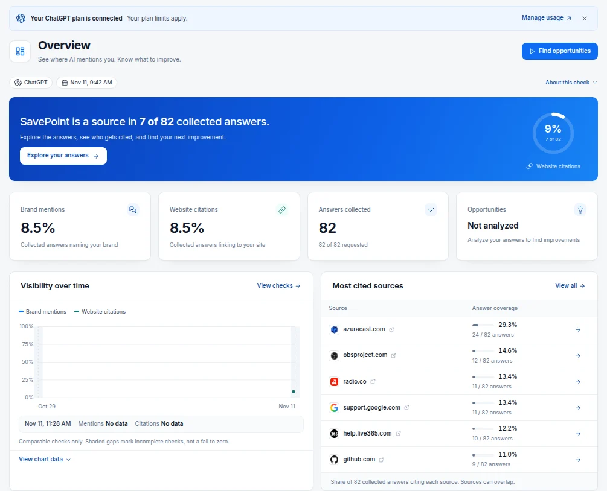
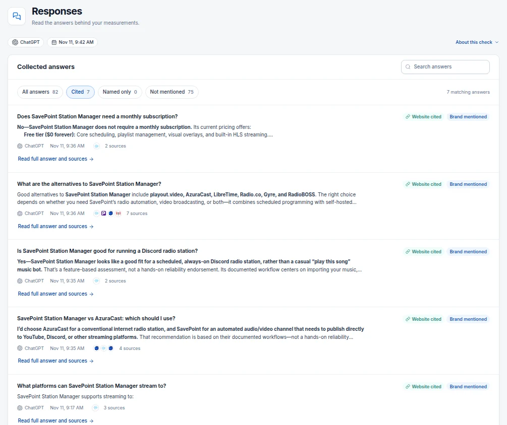
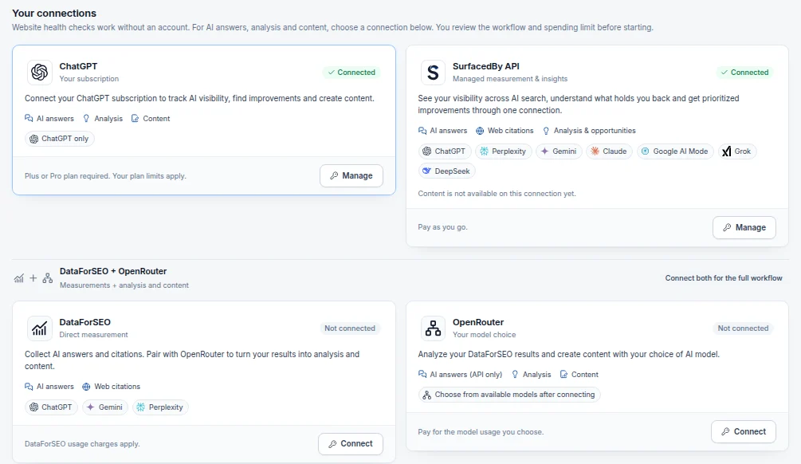

SavePoint Station Manager is self-hosted software for running a 24/7 station: online radio, or a live channel on YouTube, Twitch, Kick, Discord and Mixcloud. I build it, and savepoint.fm is its home.

On 11 November 2026, my OpenGEO put 82 questions a station owner might ask to ChatGPT. Seven of them named SavePoint, and all seven answers named SavePoint and linked to savepoint.fm. The other 75 asked about the category, such as which software can run an MP3 stream server for a 24/7 internet radio station, and SavePoint appeared in none of them.

[NEEDS: why AI visibility matters for SavePoint.fm, in Hudson's words]

This article explains what generative engine optimization is, how a citation differs from a recommendation, and why I care more about being recommended. It shows how I measure all of it with OpenGEO, a free open-source tool, and how I hand OpenGEO to a Claude Code agent through its MCP server. The last sections cover SurfacedBy, the company behind OpenGEO, and what its hosted service adds.

## Generative engine optimization for AI search

Generative engine optimization (GEO), also called answer engine optimization (AEO), is the work of tracking and improving how AI assistants answer the questions your customers ask.[^1] A search engine returns a list of links. ChatGPT, Perplexity, Gemini and the others return an answer, and that answer names your product or it does not.

Measuring it starts with a list of questions. You collect the answers each AI platform gives, then check every answer for two things: does it name your brand, and does it link to your site? OpenGEO keeps each answer and each link, so every number can be traced back to the answers behind it, and it states that it cannot promise a mention, a citation or a ranking.[^1]



## Citations and recommendations in AI answers

A citation is a link. When ChatGPT searches the web to answer a question, it can attach the pages it used as sources. OpenGEO counts an answer as citing your site when one of those links points at your domain or one of its subdomains, and it reads the links from the provider's own annotations rather than guessing them from the answer text.[^2] The citation rate is the share of answers that link to you.

A recommendation is your brand given as the answer. OpenGEO's mention rate, the share of answers that name your brand, is the nearest measure it has, but a mention is not always a recommendation. One of SavePoint's cited answers shows the gap. Asked for alternatives to SavePoint Station Manager, ChatGPT named SavePoint, linked to savepoint.fm, and recommended six other products.



## Recommendations first for product discovery

Of the two, being recommended matters more to me. [NEEDS: Hudson's reason, in his words]

SavePoint is cited only where it is already known. On 29 October 2026 it was named in none of 70 answers to category questions and in all 7 answers to questions that named it. The check on 11 November came out almost the same: 0 of 75 and 7 of 7.

OpenGEO also saves the web searches ChatGPT runs behind each answer, and they account for part of the gap. Across four checks from 30 October to 6 November 2026, 31 of 1,385 searches were plain category searches, about 2%. In most answers the first search already named a product or went straight to a product's own site.

Comparison pages are one way onto those searches. Pages that compare products or list alternatives were cited 10 times across 311 answers in five checks, and 2 of those were savepoint.fm pages: our Radio.co alternatives post was cited for a Radio.co search on 30 October. Twelve of the 47 competitors I track publish per-competitor comparison pages, and none of those pages covers SavePoint. On 9 November I published the first of a set of feature spotlights, on Manual Play, in 11 languages. It is too early to report a result.

```callout note small
OpenGEO's ChatGPT connection collects answers through OpenAI's API, which can differ from what a person sees in the ChatGPT app. One check is a sample; the series of checks is what to read.
```

## OpenGEO's MCP server in Claude Code

OpenGEO ships an MCP server, so an AI agent such as Claude Code can work with it directly.[^3] It runs over standard input and output (`node dist-server/mcp.js`), and the 0.1.0-beta.6 release offers twelve tools:

- `list_projects` and `read_workspace` read your projects, answers, citations, opportunities and drafts.
- `start_audit` and `start_workflow` start a website audit or a measurement workflow.
- `read_job`, `preview_resume`, `resume_workflow` and `cancel_workflow` follow and control saved work.
- `list_ask_engines`, `estimate_ask`, `ask_engines` and `read_ask` put one question to several engines at once.

An agent cannot spend money on its own say-so. A paused workflow shows its spending ceiling through `preview_resume`, and it continues only after an explicit review.[^3]

My OpenGEO runs in a Docker container on a Proxmox server at home, reachable only on my private Tailscale network. Claude Code reaches it over SSH, and the whole configuration is one entry:

```json
{
  "mcpServers": {
    "opengeo": {
      "command": "ssh",
      "args": [
        "-o", "BatchMode=yes",
        "-o", "ConnectTimeout=15",
        "opengeo",
        "docker", "exec", "-i",
        "opengeo-opengeo-1",
        "node", "dist-server/mcp.js"
      ]
    }
  }
}
```

`opengeo` is a host name from my SSH configuration, and `docker exec -i` keeps standard input open so the MCP messages can pass through.

Here is a run from 11 November 2026, with Claude Code allowed only the two read tools. The request was: "Use the opengeo MCP server. Call list_projects, then read_workspace for the SavePoint project. Report, in three short lines: the project name, how many questions it tracks, and the latest ChatGPT check's brand mention rate, website citation rate and answers collected." It called `list_projects`, then `read_workspace`, and answered:

```text
- Project: SavePoint (savepoint.fm), the only
  project on the server.
- Questions tracked: 82 unique questions across
  21 Topics.
- Latest ChatGPT check (2026-11-11, gpt-6.1-sol):
  brand mention rate 8.5%, website citation rate
  8.5% (7 of 82 answers), with 82 of 82 answers
  collected.
```

Those match the overview screen above. For a project this size `read_workspace` returned 1.6 MB, more than Claude Code shows at once, so it saved the result to a file and read the parts it needed.

Day to day, a Claude Code session runs OpenGEO for me: it adds questions and Topics, reads the results and copies them into a tracking sheet. For changes it uses small scripts and OpenGEO's command line inside the container rather than the MCP server. Every change reads the whole project first, refuses to send if that read looks incomplete, then reads it back and reports which Topics moved, because a project update replaces whole lists.

## SurfacedBy, the project behind OpenGEO

SurfacedBy is a hosted AI visibility service built by Ali Khallad, a GBTI Network member ([his listing](/projects/surfacedby/)). It monitors up to seven AI platforms: ChatGPT, Perplexity, Gemini, Claude, Google AI Mode, Grok and DeepSeek.[^4]

OpenGEO is SurfacedBy's open-source project. Its code is on GitHub under SurfacedBy's account, the original application code is MIT licensed, and SurfacedBy maintains it.[^1] You can run it on your own computer or server, keep your projects in a local database and connect the AI accounts you already have.

Working this way has fed changes back into OpenGEO. Topics (grouping questions inside one project), a lighter workspace after the app hung opening a project with 763 pages, and saving the web searches ChatGPT runs behind each answer all started as pull requests from my fork, and SurfacedBy shipped the Ask feature in beta.6 with three commits from my fork in it.

## Hosted AI visibility tracking alongside OpenGEO

OpenGEO measures whatever you connect it to, and SurfacedBy reaches the platforms you cannot connect yourself. Inside OpenGEO, one SurfacedBy API connection collects answers and web citations from ChatGPT, Perplexity, Gemini, Claude, Google AI Mode, Grok and DeepSeek, and adds analysis and opportunities, paid as you go. Content drafting is not available on that connection yet.



SurfacedBy's own dashboard adds a 0 to 100 AI visibility score, daily monitoring with a weekly full check, citation tracking by source type, competitors, opportunities ranked by impact and effort, an engagement queue that holds Reddit, X and LinkedIn replies for your approval, AI traffic tracking, and its own MCP server, read-only on every plan and with write access on the Agency plan.[^4] [Plans](/outbound/surfacedby/pricing) start at $24 a month billed annually, and the code WELCOME takes 10% off the first 12 months.[^5]

I have not finished a SurfacedBy check for SavePoint yet. I added $5 of credits on 28 October 2026, and three checks of Google AI Mode, Perplexity and Gemini passed their preview, then were rejected when submitted and cancelled at no charge. Every SavePoint number in this article comes from OpenGEO and my ChatGPT plan.

```button primary
See what SurfacedBy tracks
https://gbti.network/outbound/surfacedby
```

## ChatGPT paid plans and expanding OpenGEO connections

OpenGEO can use a ChatGPT subscription in place of an API key. It implements OpenAI's published subscription-sharing protocol, needs a Plus or Pro plan, and works within that plan's limits.[^6] My SavePoint checks run on my ChatGPT plan every Monday, Wednesday and Friday at 9:00 in Chicago, and OpenGEO records them at $0.

The answers come from OpenAI's Responses API, so they can differ from the ChatGPT website or app. OpenGEO also records whether ChatGPT confirmed a web search for each answer, and in the check of 11 November it did for all 82.[^2]

The other connections are OpenRouter, for a choice of models billed by OpenRouter, and DataForSEO paired with OpenRouter, which collects answers from ChatGPT, Gemini and Perplexity.[^6] More API-based engines are being added.

## The free SurfacedBy AI visibility check

SurfacedBy's free AI visibility check runs 10 prompts on each of ChatGPT, Perplexity and Gemini and needs no credit card. It returns a visibility score, which platforms mention you, the competitors that appear, and the top actions to take.[^4] Paid plans start at $24 a month billed annually, with a 7-day trial.[^5]

```button primary
Try the free SurfacedBy AI visibility check
https://gbti.network/outbound/surfacedby
```

[^1]: [OpenGEO on GitHub](https://github.com/surfacedby/OpenGEO): what it measures, that it is maintained by SurfacedBy, and its MIT licence. Read 11 November 2026.

[^2]: [OpenGEO: How measurements work](https://github.com/surfacedby/OpenGEO/blob/master/docs/methodology.md): mention rate, citation rate, citations from provider annotations and confirmed web searches.

[^3]: [OpenGEO: Development](https://github.com/surfacedby/OpenGEO/blob/master/docs/development.md): the command line and the MCP server, with the twelve tools in `server/mcp.ts` of the 0.1.0-beta.6 release.

[^4]: [SurfacedBy](/outbound/surfacedby): the platforms it monitors, the free check and its features. Read 4 November 2026.

[^5]: [SurfacedBy pricing](/outbound/surfacedby/pricing): plans, the WELCOME code and the 7-day trial. Read 11 November 2026.

[^6]: [OpenGEO: Connections](https://github.com/surfacedby/OpenGEO/blob/master/docs/connections.md): the ChatGPT subscription, OpenRouter, DataForSEO and the SurfacedBy API.
