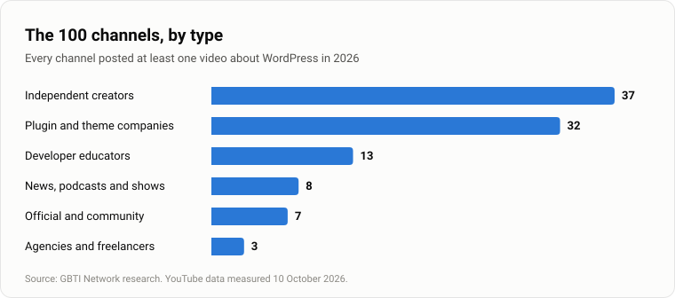

The GBTI Network has assembled a research list of 100 WordPress YouTube channels to follow in 2026. The list is built for WordPress users, builders and developers who want a specific, measured guide to where the community is publishing video this year.

## Assembling the 2026 List: Our Selection Process

To be included, a channel had to meet one rule: it posted at least one video about WordPress in 2026. The GBTI Network found 199 channels that met this rule. To further narrow the selection, we created an inclusion algorithm that considered the density of WordPress-based publishing and the age of the YouTube account creating videos, including WordPress.

We also made sure that official channels were included regardless of posting activity: the official WordPress channel, WordCamp Europe, WordCamp Asia, Gutenberg Times and WP Tavern. These five are present regardless of score.

Channels that sell their own product, meaning plugin and theme companies and hosting companies, have their inclusion weight reduced, so this list leans toward channels that teach and report on WordPress-related topics with less product-driven commercial incentive to do so, other than to expand their influence.

## The Breakdown: Types of Channels Surveyed

### Who makes WordPress videos in 2026?

The 100 channels featured in this article are organized into **seven types.** Independent creators make up the largest group at **39**. Plugin and theme companies are the next largest at **28**. Developer educators account for **13**, news, podcasts and shows for **8**, official and community for **7**, agencies and freelancers for **4**, and hosting companies for **1.**

The channels vary widely in size. The median channel has **9,475 subscribers**. Fifteen channels have **100,000 subscribers** or more, while 21 have fewer than 1,000. Together, the 100 posted **4,122 videos about WordPress in 2026**.

_The 100 channels by type. YouTube data measured 10 October 2026._

### What is the topic density related to WordPress for these channels?

Across all 100 channels, 4,122 of the 6,230 videos posted in 2026 are about WordPress. That is 66% of total videos posted. So this list ended up representing channels that trend to creating videos about or involving WordPress.

The share of WordPress content differs by channel type. Plugin and theme companies have the highest share at 83%. Developer educators are at 80%, agencies and freelancers at 67%, independent creators at 62%, official and community channels at 58%, and news, podcasts and shows at 49%.

_Share of 2026 videos about WordPress, by channel type. YouTube data measured 10 October 2026._

### AI is in one title in five

Of the 6,230 titles posted by the 100 channels in 2026, 1,258 use an AI term. That is 20%, or one title in five. The terms counted are AI, Claude, ChatGPT, GPT, Gemini, LLM, MCP, agentic, vibe coding, Copilot, OpenAI, Anthropic and n8n. Seventy-two of the 100 channels used an AI term in at least one 2026 title.

By type, developer educators use AI terms most: 42% of their 2026 titles include one. News, podcasts and shows follow at 27%, independent creators at 21%, official and community channels at 14%, plugin and theme companies at 13%, and agencies and freelancers at 12%. The single hosting company is at 33%, which is one channel.

Two examples from Elliott Richmond show the pattern: "Connect Claude Code to WordPress with MCP (Then Lock It Down)" and "WordPress.com Just Released a Claude Code Plugin for WordPress - Here's What It Does".

_Share of 2026 video titles that mention AI, by channel type. YouTube data measured 10 October 2026._

### The year of the "Is WordPress dead?" video

Channels published videos with the following titles in 2026:

- "Is WordPress Dead? My Honest Take on AI vs WordPress" (WPTuts)
- "Is WordPress Dead Because of AI? My Honest Opinion" (Academia de Hostinger)
- "WordPress vs. AI: Is WordPress Dead?" (the WP Minute podcasts)
- "WordPress is dead! We tested EmDash CMS, the new WP Killer" (WordPress Help)
- "Its been fun, WordPress." (Jonathan Jernigan)
- "Why I Don't Use WordPress Anymore" (Mark Szymanski)
- "STOP SELLING WORDPRESS WEBSITES" (PixemWeb)
- The other side: "You Don't Have to Leave WordPress to Work With AI" (The Admin Bar)

### Still long-form

Short-form video has not taken over WordPress YouTube. The median channel among the 100 puts 5% of its uploads into Shorts. Twenty channels have posted no Shorts at all, and 5 post mostly Shorts. WordPress YouTube is still long-form.

### About these numbers

Topic share and AI share are measured on titles, not on what is said in the videos. Subscriber counts are YouTube's rounded public figures. Upload dates older than a few weeks are month-grained on YouTube; channels whose only qualifying video sat near 1 January were checked against the video's exact date.

## Official and community

This section holds 7 channels that represent the official project and the broader WordPress community. Four of the five channels that are always included sit here: the official WordPress channel, WordCamp Europe, WordCamp Asia and Gutenberg Times. The fifth, WP Tavern, is listed under news, podcasts and shows.

### 12. WordCamp Asia

WordCamp Asia publishes talks and behind-the-scenes coverage from what the channel describes as the premier open source web summit of Asia. The channel records sessions on WordPress for startup founders, content security policy, HTML parsing, and design longevity, alongside introductions to the event's emcees, volunteers, and organizing teams. The channel's description addresses developers, digital marketers, UI/UX designers, and tech entrepreneurs.

625 subscribers · 93% of 2026 videos about WordPress · 39 WordPress videos in 2026 · Always included

[Subscribe to @wordcampasia](https://www.youtube.com/@wordcampasia?sub_confirmation=1)

### 26. Hong Kong WordPress Meetup

Hong Kong WordPress Meetup posts recordings of its local meetup sessions, with talks delivered in both English and Chinese. Recent subjects include digital accessibility, AI-assisted design, user experience principles applied to WordPress, and comparisons of WordPress with Hugo and Astro as open source content management systems.

21 subscribers · 100% of 2026 videos about WordPress · 13 WordPress videos in 2026

[Subscribe to @Hong-Kong-WordPress-Meetup](https://www.youtube.com/@Hong-Kong-WordPress-Meetup?sub_confirmation=1)

### 38. WPVaat

WPVaat publishes content in Gujarati on WordPress trends, principles, and practical guidance. The channel produces podcast episodes and event coverage, including a run of videos on WordCamp Rajasthan 2026 covering venue selection, attendee experiences, local tourism, and the planning work behind the event. According to its description, the channel aims to make technology discussions accessible across generations and says it is working to add subtitles to every video so that viewers with hearing disabilities can follow along.

369 subscribers · 42% of 2026 videos about WordPress · 61 WordPress videos in 2026 · In Gujarati

[Subscribe to @wpvaat](https://www.youtube.com/@wpvaat?sub_confirmation=1)

### 51. WordCamp Europe

WordCamp Europe publishes talks and event programming from the community-organised gathering of WordPress enthusiasts. The channel covers contributor day activities, WordPress education programmes, volunteer guidance, sponsor operations, the design team (the Design Dragons), and a photography workflow, alongside practical attendee tips for the conference. The channel describes the gathering as drawing everyone from casual users to Core developers.

492 subscribers · 77% of 2026 videos about WordPress · 10 WordPress videos in 2026 · Always included

[Subscribe to @wordcampeurope](https://www.youtube.com/@wordcampeurope?sub_confirmation=1)

### 63. The Admin Bar

The Admin Bar publishes WordPress tutorials, interviews, and product demos presented by Kyle Van Deusen. The channel describes itself as the place for WordPress professionals to ask questions and find answers, and its 2026 titles concentrate on GenerateBlocks features including design tokens, form builders, and CSS editors, alongside broader subjects such as cookie compliance, artificial intelligence integration, and techniques for faster, more consistent website builds.

15.3K subscribers · 32% of 2026 videos about WordPress · 10 WordPress videos in 2026

[Subscribe to @TheAdminBar](https://www.youtube.com/@TheAdminBar?sub_confirmation=1)

### 93. Gutenberg Times

The Gutenberg Times channel describes itself as curating community voices around the block editor and says it hosts a bi-monthly live Q&A, lately in a panel plus host format. The channel publishes changelog episodes tracking Gutenberg plugin releases and WordPress version milestones, with discussion of proposals for core, calls for testing, and development notes.

569 subscribers · 100% of 2026 videos about WordPress · 8 WordPress videos in 2026 · Always included

[Subscribe to @GutenbergTimes](https://www.youtube.com/@GutenbergTimes?sub_confirmation=1)

### 100. WordPress (official channel)

The official WordPress channel publishes a multilingual mix of content including performance optimization with AI agents, programming education in the age of artificial intelligence, server infrastructure comparisons, and search engine optimization for large language model citation. The channel also carries personal branding guidance and podcast production systems. Some titles are in Polish.

118K subscribers · 60% of 2026 videos about WordPress · 240 WordPress videos in 2026 · Always included

[Subscribe to @WordPress](https://www.youtube.com/@WordPress?sub_confirmation=1)

## News, podcasts and shows

This section holds 8 channels that publish WordPress news, podcasts and regular shows.

### 43. WordPress Plugins from A to Z

WP Plugins A to Z says it runs a live show every Monday with plugin reviews and community discussion. Amber and John describe, review, and rate free, freemium, and premium WordPress plugins on air, alongside WordPress and tech news. Every other week, John hosts live interviews with WordPress community members or a solo show on Plugin Pulse, covering topics from site hardening to plugin repository changes and WordPress 7.0 updates.

854 subscribers · 94% of 2026 videos about WordPress · 31 WordPress videos in 2026

[Subscribe to @Wppluginsatoz](https://www.youtube.com/@Wppluginsatoz?sub_confirmation=1)

### 46. WP Builds

WP Builds describes itself as a weekly WordPress podcast and news update hosted by Nathan Wrigley with David Waumsley. The channel says it aims to cover plugins, themes, hosting, and SaaS apps, and its 2026 titles include interviews on accessibility, multisite translation, and the transition from classic themes to the block editor. It also hosts webinars and runs a deals page for WordPress products.

1.9K subscribers · 84% of 2026 videos about WordPress · 71 WordPress videos in 2026

[Subscribe to @WPBuilds](https://www.youtube.com/@WPBuilds?sub_confirmation=1)

### 49. WordPress Help

WordPress Help is a Spanish-language channel from Fernando Tellado with tutorials, guides, live website analysis, and commentary on WordPress. The 2026 catalog covers hacked site recovery, robots.txt on multisite networks, AI files for search engines, and WordPress 7.2 alongside security plugins and the block editor. Titles include the #DoctorWordPress tips and consultations show and the #WordPressChronicles news and commentary show, both with Fernando Tellado.

5.5K subscribers · 59% of 2026 videos about WordPress · 82 WordPress videos in 2026 · In Spanish

[Subscribe to @AyudaWPes](https://www.youtube.com/@AyudaWPes?sub_confirmation=1)

### 64. WP Tavern

WordPress Tavern publishes interview-driven episodes on the people and mechanics of the WordPress ecosystem. The 2026 lineup covers project contracts for AI development, security in the AI era, trust in hosting, legacy PHP risks, and the bridge between WordPress education and industry. Other episodes address accessibility in themes, beginner anxiety, and the state of freelance WordPress work on platforms like Upwork.

168 subscribers · 80% of 2026 videos about WordPress · 31 WordPress videos in 2026 · Always included

[Subscribe to @wptavern](https://www.youtube.com/@wptavern?sub_confirmation=1)

### 79. Within WordPress

Within WordPress publishes interviews and event coverage with a focus on agency strategy, publishing workflows, and technical SEO. The 2026 episodes include conversations on agentic search, WooCommerce development, JavaScript-only sites, and CloudFest business programming. One episode is about growing a YouTube channel with WordPress tutorials while building a pizza business.

203 subscribers · 83% of 2026 videos about WordPress · 5 WordPress videos in 2026

[Subscribe to @WithinWordPress](https://www.youtube.com/@WithinWordPress?sub_confirmation=1)

### 80. WPMayor

WPMayor reviews WordPress tools and services, and describes its aim as helping viewers get to know the latest ones for building sites. The 2026 coverage includes a salon booking plugin with recurring revenue features for agencies and a free block editor extension for responsive controls.

1.3K subscribers · 50% of 2026 videos about WordPress · 1 WordPress video in 2026

[Subscribe to @WPMayor](https://www.youtube.com/@WPMayor?sub_confirmation=1)

### 83. WP Minute Podcasts

WP Minute Podcasts is the home for The WP Minute and The WP Minute+ podcasts, with full episodes the channel says it uploads weekly. The 2026 catalog mixes short-form commentary on AI subscriptions, email management, and event strategy with a longer interview with Brian Richards on restructuring LoopConf around attendee-funded events. The channel also carries episodes on WordPress core development, design workflows, and letting AI run business systems.

507 subscribers · 31% of 2026 videos about WordPress · 124 WordPress videos in 2026

[Subscribe to @wpminutepodcasts](https://www.youtube.com/@wpminutepodcasts?sub_confirmation=1)

### 85. Negocios y WordPress

Negocios y WordPress is a Spanish-language podcast and community for WordPress professionals and freelancers looking to grow their business. The 2026 episodes cover AI agents, the WordPress 7.1 and 7.0 releases, performance optimization, and page builders such as Elementor and Bricks. Other topics include OpenCode, hosting from cPanel to Vercel, and experiments with AI-assisted development and design tools.

3K subscribers · 42% of 2026 videos about WordPress · 8 WordPress videos in 2026 · In Spanish

[Subscribe to @negociosWP](https://www.youtube.com/@negociosWP?sub_confirmation=1)

## Independent creators

This section holds 39 independent creators. It is the largest group in the list.

### 2. Alexis FH - Tutoriels WordPress

Alexis FH publishes French-language WordPress and WooCommerce tutorials for building professional sites, online stores, booking systems, and marketplace platforms. The channel covers AI integration with WordPress, including plugins like Novamira and Bymiles AI, and explores agentic CMS capabilities through tools such as Claude and ChatGPT connected via MCP.

71.3K subscribers · 90% of 2026 videos about WordPress · 46 WordPress videos in 2026 · In French

[Subscribe to @alexisfh](https://www.youtube.com/@alexisfh?sub_confirmation=1)

### 4. Nayyar Shaikh

Nayyar Shaikh publishes English-language WordPress tutorials focused on building complete websites for specific industries and use cases. The channel covers travel booking, real estate directories, job portals, online courses, food delivery, and eCommerce stores, often demonstrating particular themes and tools in step-by-step builds.

354K subscribers · 100% of 2026 videos about WordPress · 9 WordPress videos in 2026

[Subscribe to @NayyarShaikh](https://www.youtube.com/@NayyarShaikh?sub_confirmation=1)

### 6. JAKSON

Jakson publishes English-language WordPress tutorials with a focus on the block editor, Gutenberg patterns, and full site editing. The channel covers AI tools for WordPress, SEO strategies, server configuration, and CSS techniques, alongside reviews of WordPress releases and new builder plugins.

29.3K subscribers · 93% of 2026 videos about WordPress · 25 WordPress videos in 2026

[Subscribe to @wpjakson](https://www.youtube.com/@wpjakson?sub_confirmation=1)

### 8. Tutoriales WooCommerce - Diego Nieto

Diego Nieto publishes Spanish-language WooCommerce tutorials for managing online stores, covering product variations, pricing, checkout customization, and email configuration. The channel also addresses WordPress maintenance tasks such as PHP version changes and SMTP setup.

5.8K subscribers · 100% of 2026 videos about WordPress · 20 WordPress videos in 2026 · In Spanish

[Subscribe to @DiegoNieto](https://www.youtube.com/@DiegoNieto?sub_confirmation=1)

### 11. WPGIZ

WPGIZ publishes English-language WordPress tutorials for beginners, covering site setup, eCommerce, AI content generation, and plugin overviews. The channel emphasizes building and managing WordPress sites without coding knowledge, with walkthroughs of tools like Tutor LMS, Kirki, and WordPress.com features.

7.3K subscribers · 80% of 2026 videos about WordPress · 74 WordPress videos in 2026

[Subscribe to @WPGIZ](https://www.youtube.com/@WPGIZ?sub_confirmation=1)

### 13. WP Simple Hacks - Wordpress tips and tricks

WP Simple Hacks publishes English-language WordPress tips and workflow shortcuts for freelancers, small businesses, and consultants. The channel covers AI plugins for site optimization, WooCommerce features, CRM tools, booking systems, and browser extensions, with demonstrations of specific plugins like FunnelKit, Foenix AI, and ThinkRank AI.

17.2K subscribers · 83% of 2026 videos about WordPress · 54 WordPress videos in 2026

[Subscribe to @wpsimplehacks](https://www.youtube.com/@wpsimplehacks?sub_confirmation=1)

### 14. Let's Build WordPress

Martie at Let's Build WordPress publishes English-language WordPress tutorials for beginners, covering fundamental tasks such as installing WordPress, adding HTML, creating image links, and fixing common issues. The channel describes itself as having taught a large audience and requires no prior coding experience.

33.5K subscribers · 100% of 2026 videos about WordPress · 6 WordPress videos in 2026

[Subscribe to @LetsBuildWordPress](https://www.youtube.com/@LetsBuildWordPress?sub_confirmation=1)

### 16. Edwin Cepeda Web

Edwin Cepeda Web publishes Spanish-language Elementor tutorials ranging from beginner guides to advanced techniques for WordPress design. The channel covers Elementor Pro updates, addon configurations, WooCommerce payment setup, and AI-assisted website building, with walkthroughs of specific tools like Royal Elementor Addons and Happy Addons.

1.7K subscribers · 86% of 2026 videos about WordPress · 12 WordPress videos in 2026 · In Spanish

[Subscribe to @EdwinCepedaWeb](https://www.youtube.com/@EdwinCepedaWeb?sub_confirmation=1)

### 17. WordPress Tutorials - WPLearningLab

WPLearningLab publishes English-language WordPress tutorials focused on fundamentals, Elementor skills, eCommerce, and dynamic websites. The channel covers security setup, migration tools, maintenance pages, WooCommerce customization, and multilingual SEO, with an emphasis on applying these skills to generate income.

163K subscribers · 96% of 2026 videos about WordPress · 54 WordPress videos in 2026

[Subscribe to @wplearninglab](https://www.youtube.com/@wplearninglab?sub_confirmation=1)

### 18. Jeffrey @ Lytbox

Jeffrey at Lytbox publishes English-language content on AI tools for WordPress, including MCP servers, agent setups, and code-based workflows. The channel covers Claude Code integration, shader effects, animation with GSAP, and comparisons of AI builders, alongside explorations of alternative CMS platforms.

44.9K subscribers · 62% of 2026 videos about WordPress · 23 WordPress videos in 2026

[Subscribe to @Lytbox_Academy](https://www.youtube.com/@Lytbox_Academy?sub_confirmation=1)

### 19. SiteKrafter

SiteKrafter publishes English-language content focused on Divi 5, including live Q&A sessions, workflow tutorials, and AI agent demonstrations. The channel covers page building, rebranding techniques, and video hosting alternatives, with walkthroughs of specific Divi 5 features and integrations.

85.3K subscribers · 86% of 2026 videos about WordPress · 124 WordPress videos in 2026

[Subscribe to @sitekrafter](https://www.youtube.com/@sitekrafter?sub_confirmation=1)

### 20. WPMarmite - Créez et lancez votre site WordPress

WPMarmite publishes French-language WordPress tutorials for creating, customizing, and launching sites. The channel covers security plugins, professional site builds for specific industries, AI-assisted design tools, and WordPress Playground for testing legacy versions, with a recurring series following a site project from concept through visual identity.

72.4K subscribers · 69% of 2026 videos about WordPress · 167 WordPress videos in 2026 · In French

[Subscribe to @WPMarmite](https://www.youtube.com/@WPMarmite?sub_confirmation=1)

### 21. WPSimplified

WPSimplified publishes Hindi and Hinglish WordPress tutorials for beginners and aspiring developers. The channel covers site building, plugin reviews, WooCommerce setup, and advanced tools like WP-CLI and Git, alongside WordCamp event coverage and community networking guidance.

1.4K subscribers · 82% of 2026 videos about WordPress · 175 WordPress videos in 2026

[Subscribe to @WPSimplifiedBySunil](https://www.youtube.com/@WPSimplifiedBySunil?sub_confirmation=1)

### 22. Darrel Wilson

Darrel Wilson publishes English-language WordPress and Elementor tutorials, alongside content on AI website builders, SEO, and online business strategies. The channel also releases separate editions in Spanish, Portuguese, French, German, Italian, Arabic, and Japanese.

528K subscribers · 51% of 2026 videos about WordPress · 40 WordPress videos in 2026

[Subscribe to @darrelwilson](https://www.youtube.com/@darrelwilson?sub_confirmation=1)

### 23. WPTuts

WPTuts publishes English-language WordPress content for freelancers and professionals, covering tools such as Bricks, Elementor, GenerateBlocks, ACF, JetEngine, and MetaBox. The channel addresses AI builders, static site generation, security plugins, email delivery, and alternative CMS options such as EmDash and Astro, with discussions of industry developments and workflow optimization.

186K subscribers · 62% of 2026 videos about WordPress · 77 WordPress videos in 2026

[Subscribe to @WPTuts](https://www.youtube.com/@WPTuts?sub_confirmation=1)

### 27. La Máquina del Branding

La Máquina del Branding publishes Spanish-language content on building digital projects with WordPress, including AI-assisted workflows, plugin development, and performance optimization. The channel offers a free WordPress course covering hooks, queries, functions, and PHP fundamentals, alongside podcast episodes and community resources.

45.2K subscribers · 75% of 2026 videos about WordPress · 42 WordPress videos in 2026 · In Spanish

[Subscribe to @yan_lmb](https://www.youtube.com/@yan_lmb?sub_confirmation=1)

### 28. Brendan O'Connell

Brendan O'Connell publishes English-language WordPress content focused on Bricks Builder, AI tools, and alternative workflows. The channel covers Claude Code integration, agent skills, plugin development, and design tool comparisons, alongside explorations of static site options and open-source alternatives to commercial AI tools.

12.4K subscribers · 62% of 2026 videos about WordPress · 10 WordPress videos in 2026

[Subscribe to @BrendanOConnellWP](https://www.youtube.com/@BrendanOConnellWP?sub_confirmation=1)

### 29. Rino de Boer

Rino de Boer publishes English-language WordPress content examining AI tools, builder plugins, and the evolving role of page builders. The channel covers vibe coding implementations, AI theme development, and comparisons of AI models for website building.

281K subscribers · 58% of 2026 videos about WordPress · 55 WordPress videos in 2026

[Subscribe to @rinodeboer](https://www.youtube.com/@rinodeboer?sub_confirmation=1)

### 30. Comunidad ElemenPros - Elementor & WordPress

Comunidad ElemenPros publishes Spanish-language Elementor and WordPress tutorials. The channel covers Elementor beta releases, version updates, and new features, with content aimed at Spanish-speaking users of the Elementor ecosystem.

13.1K subscribers · 100% of 2026 videos about WordPress · 2 WordPress videos in 2026 · In Spanish

[Subscribe to @elemenpros](https://www.youtube.com/@elemenpros?sub_confirmation=1)

### 31. WP Minute Tutorials

WP Minute Tutorials publishes English-language WordPress tutorials for beginners, covering core components, default themes, and popular plugins. The channel also reports on WordPress business and community news, with coverage of AI tools, hosting options, and platform developments.

20.1K subscribers · 64% of 2026 videos about WordPress · 16 WordPress videos in 2026

[Subscribe to @WPMinute](https://www.youtube.com/@WPMinute?sub_confirmation=1)

### 32. MarketHax | Cursos de WordPress y WooCommerce

MarketHax publishes Spanish-language WordPress and WooCommerce free courses, covering website creation, online store setup, and AI-assisted building. The channel includes tutorials on booking systems, blog integration, SEO optimization, and the Gutenberg block editor.

349K subscribers · 57% of 2026 videos about WordPress · 24 WordPress videos in 2026 · In Spanish

[Subscribe to @markethax](https://www.youtube.com/@markethax?sub_confirmation=1)

### 35. sergioks

sergioks publishes Spanish-language WordPress tutorials for people who are not programmers, covering AI tools, SEO workflows, and WooCommerce management. The channel compares plugins, explores headless WordPress hosting options, and demonstrates connecting WordPress to Claude via MCP for content and search optimization.

22.9K subscribers · 70% of 2026 videos about WordPress · 58 WordPress videos in 2026 · In Spanish

[Subscribe to @sergioks](https://www.youtube.com/@sergioks?sub_confirmation=1)

### 37. Jonathan Jernigan

Jonathan Jernigan publishes English-language WordPress content spanning tutorials, live streams, and discussions. The channel covers DNS fundamentals, query loop implementations with GenerateBlocks, and broader discussions of the WordPress ecosystem.

12.1K subscribers · 67% of 2026 videos about WordPress · 2 WordPress videos in 2026

[Subscribe to @Permaslug](https://www.youtube.com/@Permaslug?sub_confirmation=1)

### 42. WPEspresso

WPEspresso publishes English-language WordPress tutorials for non-developers, emphasizing speed and simplicity in site building without coding. The channel targets freelancers, entrepreneurs, and beginners, with walkthroughs of beginner-friendly tools and plugins.

9.6K subscribers · 100% of 2026 videos about WordPress · 1 WordPress video in 2026

[Subscribe to @Wpespresso](https://www.youtube.com/@Wpespresso?sub_confirmation=1)

### 44. BestInWP

BestInWP publishes English-language WordPress content for product owners, marketers, and agency founders, focusing on reviews, which the channel describes as honest and workflow demonstrations. The channel covers MCP server setup, AI agency tools, CRM systems, and eCommerce plugin comparisons, with deep dives into specific products like Novamira, OneSuite, and FluentCart.

56 subscribers · 61% of 2026 videos about WordPress · 17 WordPress videos in 2026

[Subscribe to @BestInWP](https://www.youtube.com/@BestInWP?sub_confirmation=1)

### 48. Imran Siddiq - Web Squadron

Imran Siddiq at Web Squadron publishes English-language WordPress design and business content, with a focus on Elementor tutorials and live business discussions. The channel covers CSS techniques, cookie compliance, AI-assisted redesigns, and MCP challenges, alongside live chat sessions about web design business operations.

196K subscribers · 50% of 2026 videos about WordPress · 137 WordPress videos in 2026

[Subscribe to @websquadron](https://www.youtube.com/@websquadron?sub_confirmation=1)

### 53. Curso WordPress Definitivo

Videoaulas, dicas e tutoriais sobre WordPress e WooCommerce. The channel publishes in Portuguese, with content covering store setup in WooCommerce, product and shipping configuration, payment integration with Mercado Pago and Correios, and foundational WordPress skills including menus, headers, and email configuration. Tutorials range from complete purchase flows to specific regional shipping rules for Brazilian stores.

60K subscribers · 83% of 2026 videos about WordPress · 25 WordPress videos in 2026 · In Portuguese

[Subscribe to @wpdefinitivo](https://www.youtube.com/@wpdefinitivo?sub_confirmation=1)

### 57. Create a Pro Website

Tutorials on building websites without code, with a 2026 focus on AI-assisted creation using Claude and GPT-6 Astra alongside WordPress and Elementor. The channel covers portfolio and business sites, deployment methods, domain selection, and income generation from simple websites. Formats include full build walkthroughs, tool comparisons, and beginner-oriented WordPress introductions.

496K subscribers · 24% of 2026 videos about WordPress · 8 WordPress videos in 2026

[Subscribe to @CreateaProWebsite](https://www.youtube.com/@CreateaProWebsite?sub_confirmation=1)

### 60. Ferdy Korpershoek

Ferdy Korpershoek publishes tutorials on building WordPress websites with free and paid tools, including Elementor, Divi, CartFlows, LearnDash, and various themes. The channel focuses on monetization through services, products, courses, advertising, and affiliate marketing. 2026 titles emphasize AI integration in web design, with coverage of Elementor MCP, ChatGPT-6 Astra and Claude Fable 5.1 for client work and business transformation.

1.24M subscribers · 43% of 2026 videos about WordPress · 34 WordPress videos in 2026

[Subscribe to @ferdycom](https://www.youtube.com/@ferdycom?sub_confirmation=1)

### 70. Emmanuel Gutiérrez / Diseño Web en Wordpress

Emmanuel Gutiérrez publishes Spanish-language WordPress content focused on Divi 5, covering typography, color editing, timeline modules, and language configuration. The channel also addresses WordPress maintenance automation, local SEO strategies, and AI-assisted website creation.

14.7K subscribers · 78% of 2026 videos about WordPress · 14 WordPress videos in 2026 · In Spanish

[Subscribe to @emmanuelgutierrezdesarroll624](https://www.youtube.com/@emmanuelgutierrezdesarroll624?sub_confirmation=1)

### 71. Descomplicando Sites

Descomplicando Sites publishes Portuguese-language WordPress, Elementor, and WooCommerce tutorials for beginners, with step-by-step site creation guidance. The channel covers AI integrations including Claude and ChatGPT, payment setup for Brazilian markets, Chrome extension development, and selling websites, including high-ticket websites.

224K subscribers · 27% of 2026 videos about WordPress · 25 WordPress videos in 2026 · In Portuguese

[Subscribe to @DescomplicandoSites](https://www.youtube.com/@DescomplicandoSites?sub_confirmation=1)

### 75. Alex Cooper

Alex Cooper publishes English-language content on AI, online business, and WordPress, including marketplace builds, animation tools, and performance optimization. The channel covers side projects, SaaS sales with WordPress plugins, and AI learning resources, alongside broader topics in self-development and internet business models.

69.3K subscribers · 51% of 2026 videos about WordPress · 22 WordPress videos in 2026

[Subscribe to @alexcooperai](https://www.youtube.com/@alexcooperai?sub_confirmation=1)

### 76. Craylor

Craylor publishes English-language software recommendations and tutorials for entrepreneurs, with WordPress content covering AI tools, hosting, and website building. The channel includes coverage of WordCamp events, community questions, and broader explorations of AI's impact on the WordPress ecosystem.

64.2K subscribers · 32% of 2026 videos about WordPress · 12 WordPress videos in 2026

[Subscribe to @craylor](https://www.youtube.com/@craylor?sub_confirmation=1)

### 77. Jamie WP

Jamie WP publishes English-language WordPress content with a focus on eCommerce, email automation, and plugin integrations. The channel covers Claude Cowork connections, sticky header techniques, scam awareness, and strategies for repeat purchases and triggered email campaigns in online stores.

209K subscribers · 32% of 2026 videos about WordPress · 6 WordPress videos in 2026

[Subscribe to @jamiewp](https://www.youtube.com/@jamiewp?sub_confirmation=1)

### 88. Make Dream Website

Make Dream Website publishes English-language WordPress tutorials demonstrating AI-assisted website building with Claude Fable and Claude Design. The channel covers 3D website creation, portfolio builds, animation effects, and deployment to hosting, alongside Elementor tutorials for advanced menu and hover effects.

50.9K subscribers · 22% of 2026 videos about WordPress · 2 WordPress videos in 2026

[Subscribe to @MakeDreamWebsite](https://www.youtube.com/@MakeDreamWebsite?sub_confirmation=1)

### 92. WPBeginner

WPBeginner publishes English-language WordPress tutorials for building sites, increasing traffic, and growing online businesses. The channel covers AI website building, form creation, menu editing, and WordPress updates, with walkthroughs of tools like WPVibe and demonstrations of tasks delegated to ChatGPT.

1M subscribers · 40% of 2026 videos about WordPress · 57 WordPress videos in 2026

[Subscribe to @wpbeginner](https://www.youtube.com/@wpbeginner?sub_confirmation=1)

### 94. Dave Foy

Dave Foy publishes English-language WordPress tutorials for non-coder web designers, with a focus on the Bricks builder. The channel covers AI integration workflows, CSS class strategies, and practical experiments with letting AI tools build within Bricks.

21.5K subscribers · 33% of 2026 videos about WordPress · 1 WordPress video in 2026

[Subscribe to @DaveFoy](https://www.youtube.com/@DaveFoy?sub_confirmation=1)

### 98. WP Arabic

WP Arabic publishes Arabic-language WordPress and WooCommerce tutorials for beginners, covering site building, eCommerce setup, and online business strategies. The channel addresses payment methods for Algerian markets, hosting comparisons, and dropshipping or affiliate marketing approaches, and at least one live stream and product-focused discussions.

63K subscribers · 46% of 2026 videos about WordPress · 43 WordPress videos in 2026 · In Arabic

[Subscribe to @arabicwp](https://www.youtube.com/@arabicwp?sub_confirmation=1)

### 99. Mesaque M. Academia Web Pro-X

Mesaque M. at Academia Web Pro-X publishes Portuguese-language WordPress and Elementor tutorials for beginners, emphasizing low-code and AI-assisted approaches. The channel covers n8n automation, AI integration for business scaling, and vibe coding techniques, alongside WordPress connector setups for major AI platforms and automated content generation tools.

79.6K subscribers · 34% of 2026 videos about WordPress · 36 WordPress videos in 2026 · In Portuguese

[Subscribe to @AcademiaWPX](https://www.youtube.com/@AcademiaWPX?sub_confirmation=1)

## Developer educators

This section holds 13 channels focused on teaching WordPress development. It is the third-largest group in the list.

### 1. Elliott Richmond

Elliott Richmond offers tutorials and step-by-step guides on WordPress themes, plugins, and WooCommerce development. The channel describes the presenter as a co-founder of a local WordPress meetup with experience in the platform from its early days. Recent titles cover WordPress Studio's AI interface, MCP server integration with Claude Code, WordPress 7.1 reviews, debugging with Xdebug, and WordPress Playground for client training.

4.5K subscribers · 100% of 2026 videos about WordPress · 24 WordPress videos in 2026

[Subscribe to @elliottrichmondwp](https://www.youtube.com/@elliottrichmondwp?sub_confirmation=1)

### 3. WP Workshop

WP Workshop, created by Karol, says it posts new videos weekly, with tutorials on WordPress workflows, plugins, automations, and quick fixes for creators, bloggers, marketers, and freelancers. The channel tests AI plugins, compares image optimization tools, and evaluates themes for Elementor. Recent titles include examinations of AI content generation, plugin performance testing, and new features in WordPress 7.1.

359 subscribers · 88% of 2026 videos about WordPress · 60 WordPress videos in 2026

[Subscribe to @wpworkshophq](https://www.youtube.com/@wpworkshophq?sub_confirmation=1)

### 9. Brian Coords

The channel describes Brian Coords as a WordPress developer educator and host of the Webmasters podcast. The channel covers block themes, custom post types, and PHP-only block development. Recent titles address Spacefast with Woo Store API, components for WordPress block themes, and zero-build development approaches in WordPress 7.0.

3.6K subscribers · 100% of 2026 videos about WordPress · 4 WordPress videos in 2026

[Subscribe to @BrianCoords](https://www.youtube.com/@BrianCoords?sub_confirmation=1)

### 10. Jonathan Bossenger

Jonathan Bossenger publishes AI-assisted coding videos and live streams focused on WordPress, with new recordings that the channel says arrive every Monday. The channel explores agent-first publishing, user experience fixes, plugin data handling, and MCP tools built with the facade pattern. Recent titles include coverage of the WordCamp World game and plugin showdowns.

678 subscribers · 86% of 2026 videos about WordPress · 116 WordPress videos in 2026

[Subscribe to @jon_bossenger](https://www.youtube.com/@jon_bossenger?sub_confirmation=1)

### 15. JuanMa Garrido

According to the channel, JuanMa Garrido streams every Friday about WordPress block editor development, with content primarily in Spanish. The channel covers WordPress 7.1 and 7.0 releases, block theme development with Claude Code, site health monitoring, and documentation systems. Recent titles include live testing of release candidates, triaging tickets, and building AI-powered tools for WordPress workflows.

496 subscribers · 91% of 2026 videos about WordPress · 21 WordPress videos in 2026

[Subscribe to @juanmacodes](https://www.youtube.com/@juanmacodes?sub_confirmation=1)

### 24. Webkima

Webkima publishes Persian-language tutorials on WordPress theme development and programming. The channel offers sequential sessions on building WordPress themes with HTML and CSS fundamentals. Recent titles continue a numbered lesson series on theme building and programming.

7K subscribers · 100% of 2026 videos about WordPress · 33 WordPress videos in 2026 · In Persian

[Subscribe to @webkima](https://www.youtube.com/@webkima?sub_confirmation=1)

### 25. WordPress Performance Engineer Sabrina Zeidan

WordPress Performance Engineer Sabrina Zeidan describes the channel's aim as helping WordPress agencies turn performance complaints into a monthly paid service. The channel tests plugin performance impacts, diagnoses WooCommerce speed issues, and examines Core Web Vitals outcomes. Recent titles include plugin crash tests, wishlist plugin comparisons, and checkout optimization analysis.

509 subscribers · 83% of 2026 videos about WordPress · 10 WordPress videos in 2026

[Subscribe to @SabrinaZeidan](https://www.youtube.com/@SabrinaZeidan?sub_confirmation=1)

### 33. WPJohnny - WordPress Performance Guides & Reviews

WPJohnny produces WordPress performance guides and reviews. Its 2026 title is an intro demo and settings walkthrough for the WPJ Sticky Video plugin.

2.2K subscribers · 100% of 2026 videos about WordPress · 1 WordPress video in 2026

[Subscribe to @WPJohnny](https://www.youtube.com/@WPJohnny?sub_confirmation=1)

### 39. WP Speed Fix - WordPress Speed Optimization & SEO

WP Speed Fix describes itself as specialists in technical SEO and WordPress site speed optimization, offering tutorials on Core Web Vitals, backend troubleshooting, and WooCommerce performance. The channel provides configuration guides for caching plugins and site audit services. Recent titles address add-to-cart speed fixes, search function optimization, hosting-specific issues, and plugin settings for Flying Press and WP Rocket.

379 subscribers · 55% of 2026 videos about WordPress · 11 WordPress videos in 2026

[Subscribe to @wpspeedfix](https://www.youtube.com/@wpspeedfix?sub_confirmation=1)

### 54. WP Speed Matters

WP Speed Matters says it offers tips, recommendations, performance testing, and optimization techniques for WordPress sites. The channel covers improvements in WordPress 7.1, CSS and JavaScript combination strategies, and the performance impact of plugin and theme updates.

821 subscribers · 33% of 2026 videos about WordPress · 1 WordPress video in 2026

[Subscribe to @wpspeedmatters](https://www.youtube.com/@wpspeedmatters?sub_confirmation=1)

### 55. Remkus de Vries

Remkus de Vries creates tutorials, deep dives, and real-world lessons for WordPress professionals on performance, security, Cloudflare, AI, and site architecture. The channel describes the presenter as having worked with agencies, enterprise organizations, hosting companies, and product teams. Recent titles cover WooCommerce performance, child themes in modern WordPress, event participation, and a video on WordPress problems and plugins.

774 subscribers · 64% of 2026 videos about WordPress · 7 WordPress videos in 2026

[Subscribe to @remkusdevries](https://www.youtube.com/@remkusdevries?sub_confirmation=1)

### 59. Imran Sayed - Codeytek Academy

Imran Sayed of Codeytek Academy publishes coding tutorials from beginner to advanced levels across WordPress, WooCommerce, PHP, Laravel, Python, JavaScript, React, Next.js, Gatsby, Node.js, and GraphQL. The channel describes the presenter as a full stack developer, WordCamp speaker, meetup organizer, and theme and plugin developer. Recent titles include AI agent building, Claude integration with WordPress, Figma-to-theme conversion, PHP-only block registration in WordPress 7.0, and WordPress core development tooling.

33.4K subscribers · 72% of 2026 videos about WordPress · 23 WordPress videos in 2026

[Subscribe to @Codeytek](https://www.youtube.com/@Codeytek?sub_confirmation=1)

### 73. Ryan Welcher Codes

Ryan Welcher Codes focuses on custom block development, Gutenberg customization, Full Site Editing, theme.json, and modern WordPress workflows. The channel describes Ryan Welcher as a Developer Advocate sponsored by Automattic and a core contributor to WordPress and Gutenberg. The channel includes live coding streams on Twitch and covers contributions to WordPress core. Recent titles address Advanced Query Loop development, custom icons in WordPress 7.1, WordPress Studio Code, iframe handling, and third-party library integration.

2.1K subscribers · 47% of 2026 videos about WordPress · 26 WordPress videos in 2026

[Subscribe to @RyanWelcherCodes](https://www.youtube.com/@RyanWelcherCodes?sub_confirmation=1)

## Agencies and freelancers

This section holds 4 agencies and freelancers publishing video about WordPress.

### 5. Seahawk Media

Seahawk Media produces the WP Legends podcast, hosted by Gautam Khorana, alongside tutorials on WordPress search and web design fundamentals. The podcast features interviews with founders and executives across hosting, domains, SEO, and the open web. The channel describes itself as born from the WordPress community and now a global services company partnering with hosts, agencies, and SaaS companies.

93.9K subscribers · 54% of 2026 videos about WordPress · 184 WordPress videos in 2026

[Subscribe to @seahawkmedia](https://www.youtube.com/@seahawkmedia?sub_confirmation=1)

### 7. System 22 Web Design | Divi Theme Elementor WP

System 22 Web Design publishes Divi 5 tutorials, which the channel says it uploads several times a week, covering no-code effects, layouts, and WooCommerce optimizations. The channel describes its presenter as a United States-based developer with a passion for crafting websites since the 1990s. Titles in 2026 include automatic popups, scroll animations, CSS subgrid layouts, and dynamic blog pages.

28.9K subscribers · 98% of 2026 videos about WordPress · 147 WordPress videos in 2026

[Subscribe to @System22](https://www.youtube.com/@System22?sub_confirmation=1)

### 34. WPoets TV

WPoets TV covers WordPress engineering, marketing results, and open-source community stories from Pune, India. The channel describes itself as bridging high-level web engineering and marketing results, from WordPress performance and its Awesome Enterprise platform to WordCamp highlights and tech interviews. 2026 titles include coverage of WordCamp Rajasthan, IndiaFOSS 2026, Global FinTech Fest, and community contributor journeys.

113 subscribers · 63% of 2026 videos about WordPress · 87 WordPress videos in 2026

[Subscribe to @wpoetswebexperts](https://www.youtube.com/@wpoetswebexperts?sub_confirmation=1)

### 58. Highrise Digital

Highrise Digital offers WordPress development and business advice aimed at solo developers and small teams. The channel presents quick tips, live coding sessions, and conversations with industry professionals through its WP Café series. The description emphasizes practical, pragmatic approaches without prescribing a single best way, showing how the team works including its imperfections.

2.2K subscribers · 100% of 2026 videos about WordPress · 3 WordPress videos in 2026

[Subscribe to @HighriseDigital](https://www.youtube.com/@HighriseDigital?sub_confirmation=1)

## Plugin and theme companies

This section holds 28 plugin and theme companies. It is the second-largest group in the list.

### 36. Crocoblock

Crocoblock publishes tutorials on dynamic website building with its plugin suite for Elementor, Bricks, Gutenberg, and Divi. The channel covers directories, marketplaces, WooCommerce stores, booking platforms, and membership sites, with AI workflows through CrocoBuilder. The channel describes its content as for designers, developers, freelancers, and agencies, with walkthroughs on Query Builder, dynamic listings, form building, and component-based design systems.

35.6K subscribers · 91% of 2026 videos about WordPress · 82 WordPress videos in 2026

[Subscribe to @Crocoblock](https://www.youtube.com/@Crocoblock?sub_confirmation=1)

### 40. Breakdance

Breakdance offers tutorials on its all-in-one WordPress website builder, with a strong emphasis on AI-assisted site creation. The channel demonstrates building a complete site, a marketing agency site, a real estate site, and a membership course site from AI prompts, often with Claude and other agents connected through MCP. Product walkthroughs cover theme building, dynamic data, WooCommerce integration, and debugging workflows. The channel describes Breakdance as needing no coding and no plugin clutter.

8.4K subscribers · 93% of 2026 videos about WordPress · 41 WordPress videos in 2026

[Subscribe to @OfficialBreakdance](https://www.youtube.com/@OfficialBreakdance?sub_confirmation=1)

### 41. OllieWP

OllieWP focuses on modern WordPress site building with blocks, patterns, and the native site editor through the Ollie block theme. The channel teaches how to create lightweight, responsive sites without a page builder plugin, with recent attention to AI-powered content and design tools, responsive typography and spacing controls, and WooCommerce integration. The channel describes Ollie as free and performance-oriented, aimed at users who want to work within WordPress's native interface.

2.4K subscribers · 92% of 2026 videos about WordPress · 11 WordPress videos in 2026

[Subscribe to @OllieWP](https://www.youtube.com/@OllieWP?sub_confirmation=1)

### 45. Tutor LMS

Tutor LMS provides tutorials and tips for the WordPress learning management system plugin, aimed at educators and course creators. The channel covers course creation, student management, monetization, and compliance features such as GDPR setup. Recent releases focus on Tutor LMS 4.0, including the instructor experience, new quiz types, and partial and negative marking capabilities.

9.4K subscribers · 88% of 2026 videos about WordPress · 7 WordPress videos in 2026

[Subscribe to @tutorlms](https://www.youtube.com/@tutorlms?sub_confirmation=1)

### 47. Beaver Builder

Beaver Builder publishes tutorials on its WordPress page builder, with a strong focus on AI-assisted workflows in 2026. The channel demonstrates how to convert designs from Figma, ChatGPT, Lovable, and Claude into WordPress sites, along with custom module creation and MCP connections. Additional content addresses AI slop avoidance, local site building, and animated landing pages for users who want visual building without surrendering control.

5.5K subscribers · 92% of 2026 videos about WordPress · 34 WordPress videos in 2026

[Subscribe to @BeaverBuilderWP](https://www.youtube.com/@BeaverBuilderWP?sub_confirmation=1)

### 50. Formidable Forms

Formidable Forms teaches how to turn WordPress forms into applications beyond simple contact forms. The channel covers views, directories, job boards, and searchable databases built from form entries, alongside payment integrations, quiz timers, discount codes, and data protection. Recent tutorials emphasize AI connections to Claude, ChatGPT, and Cursor, plus MCP-based form building.

6.3K subscribers · 91% of 2026 videos about WordPress · 10 WordPress videos in 2026

[Subscribe to @FormidableForms](https://www.youtube.com/@FormidableForms?sub_confirmation=1)

### 52. WPForms - WordPress Forms Plugin

WPForms produces tutorials on its drag-and-drop WordPress form builder, which the channel describes as the most beginner friendly WordPress contact form plugin. The channel covers contact forms, subscription forms, payment forms, and surveys, with recent attention to AI-assisted form creation, dashboard management, spam protection, and specialized fields such as rankings and QR codes. Payment titles cover Paystack and Mercado Pago.

15.8K subscribers · 93% of 2026 videos about WordPress · 39 WordPress videos in 2026

[Subscribe to @wpforms](https://www.youtube.com/@wpforms?sub_confirmation=1)

### 56. BuddyBoss

BuddyBoss teaches how to build web apps and social networks with WordPress. The channel offers configuration guides for features such as email digests, Zoom integration, membership management, and online courses. Recent content covers the BuddyBoss 3.0 settings panel, app page building with blocks, and the NextGen app enablement and branding workflow.

17.5K subscribers · 100% of 2026 videos about WordPress · 13 WordPress videos in 2026

[Subscribe to @BuddybossWP](https://www.youtube.com/@BuddybossWP?sub_confirmation=1)

### 61. POSIMYTH - WordPress Tutorials

POSIMYTH publishes Elementor and WordPress blocks tutorials from India, with a focus on e-commerce and AI-assisted site building. The channel demonstrates WooCommerce customization, including checkout, cart, and product pages, alongside full website generation with AI prompts. The channel also promotes its own plugins: The Plus Addons for Elementor, NexterWP, UiChemy for Figma conversion, and WDesignKit for templates.

13.9K subscribers · 93% of 2026 videos about WordPress · 75 WordPress videos in 2026

[Subscribe to @posimyth](https://www.youtube.com/@posimyth?sub_confirmation=1)

### 62. WP Umbrella

WP Umbrella says it shares practical guides and real examples for WordPress professionals who manage client sites at scale. The channel covers care plan profitability, malware detection, security hardening, backup strategies, and maintenance automation. Recent content includes a title on building a profitable WordPress care business in the age of AI and titles that compare it with ManageWP.

114 subscribers · 96% of 2026 videos about WordPress · 25 WordPress videos in 2026

[Subscribe to @wpumbrella6366](https://www.youtube.com/@wpumbrella6366?sub_confirmation=1)

### 65. InstaWP

InstaWP publishes tutorials on managed WordPress hosting, which the channel describes as AI-native. The channel covers site deployment, Git integration, webhook setup, team management, and local-to-live migrations. Recent content explores WaaS models, hosting demos, WooCommerce store launches, and AI tools that convert Figma designs into WordPress pages.

1.7K subscribers · 86% of 2026 videos about WordPress · 85 WordPress videos in 2026

[Subscribe to @instawp](https://www.youtube.com/@instawp?sub_confirmation=1)

### 66. Happy Addons

Happy Addons teaches Elementor widgets and animation features. The channel focuses on GSAP-powered animations, interactive elements such as hover accordions and visual tabs, and specialized widgets including SVG draw, image trail, and marquee effects.

3.4K subscribers · 100% of 2026 videos about WordPress · 22 WordPress videos in 2026

[Subscribe to @happyaddons](https://www.youtube.com/@happyaddons?sub_confirmation=1)

### 67. FunnelKit

FunnelKit produces tutorials on WooCommerce funnel building, checkout optimization, and marketing automation. The channel covers order bumps, upsells, downsells, cart recovery, post-purchase emails, and behavioral automations. Recent releases include subscription management through Sublium, Square payment gateway setup, and Divi 5 integration for sales funnels.

11.2K subscribers · 84% of 2026 videos about WordPress · 16 WordPress videos in 2026

[Subscribe to @FunnelKitTutorials](https://www.youtube.com/@FunnelKitTutorials?sub_confirmation=1)

### 68. TranslatePress - Translation Plugin for WordPress

TranslatePress teaches visual, front-end translation for WordPress and Shopify sites. The channel covers manual versus AI translation methods, multilingual URL structures, image localization, and alt text handling. Recent tutorials demonstrate how to translate entire blogs and sites with AI without API configuration.

2.1K subscribers · 80% of 2026 videos about WordPress · 20 WordPress videos in 2026

[Subscribe to @translatepress](https://www.youtube.com/@translatepress?sub_confirmation=1)

### 69. WooCommerce

WooCommerce publishes merchant success stories and platform demonstrations from the maker of the e-commerce plugin. The channel features case studies on scaling from startup to high-volume operations, alongside a demo of building a search experience with Jetpack Search.

27.1K subscribers · 100% of 2026 videos about WordPress · 6 WordPress videos in 2026

[Subscribe to @WooCommerce](https://www.youtube.com/@WooCommerce?sub_confirmation=1)

### 74. GeneratePress

GeneratePress publishes updates and tutorials on its WordPress theme and GenerateBlocks. The channel covers design tokens for site-wide consistency, style book management, editor access controls, and overlay panels for mega menus and popups.

10.6K subscribers · 75% of 2026 videos about WordPress · 3 WordPress videos in 2026

[Subscribe to @GeneratePress](https://www.youtube.com/@GeneratePress?sub_confirmation=1)

### 78. Elegant Themes

Elegant Themes teaches Divi 5 through tutorials, live streams, and feature updates. The channel covers AI-assisted website conversion audits, copy generation, inconsistency detection, and variable management. Recent tutorials demonstrate how to convert screenshots into native Divi sections, build a complete page with queued AI instructions, and create a complete button system with AI.

225K subscribers · 73% of 2026 videos about WordPress · 85 WordPress videos in 2026

[Subscribe to @elegantthemes](https://www.youtube.com/@elegantthemes?sub_confirmation=1)

### 81. MyMainWP

MyMainWP publishes tutorials on centralized WordPress site management. The channel covers bulk updates, security monitoring, user and password management, cache control, and WooCommerce status tracking across multiple sites. Recent content includes MainWP 6.3 features, network activity review, and MCP server integration with Claude Code for workflow automation.

2K subscribers · 64% of 2026 videos about WordPress · 57 WordPress videos in 2026

[Subscribe to @MyMainWP](https://www.youtube.com/@MyMainWP?sub_confirmation=1)

### 82. Themeisle: WordPress Tutorials & Reviews

Themeisle publishes WordPress tutorials and reviews from Romania for beginners and advanced users. The channel covers image offloading to CDN, AI-assisted site building with Claude and Otter Blocks, LMS creation, and WooCommerce customization. Recent tutorials focus on connecting Claude Code to WordPress through MCP and generating complete sites from prompts.

40.8K subscribers · 85% of 2026 videos about WordPress · 102 WordPress videos in 2026

[Subscribe to @Themeisle](https://www.youtube.com/@Themeisle?sub_confirmation=1)

### 84. Build With Barn2

Build With Barn2 offers video tutorials from the United Kingdom on optimizing a website or ecommerce business, covering WordPress, Shopify, and Wix. The channel covers document libraries, wholesale registration, discount management, and WooCommerce setup, alongside live Q&A sessions. Recent content includes CSV imports, file sharing plugin comparisons, and manual order processing.

10.6K subscribers · 77% of 2026 videos about WordPress · 48 WordPress videos in 2026

[Subscribe to @buildwithbarn2](https://www.youtube.com/@buildwithbarn2?sub_confirmation=1)

### 86. wpDataTables

wpDataTables provides step-by-step guides on table, chart, and data management in WordPress. The channel demonstrates how to display form entries in sortable tables. The channel says its tutorials come from the people working on the plugin.

4.9K subscribers · 100% of 2026 videos about WordPress · 1 WordPress video in 2026

[Subscribe to @wpDataTables](https://www.youtube.com/@wpDataTables?sub_confirmation=1)

### 87. PublishPress

PublishPress teaches content publishing workflows in WordPress through its plugin suite. The channel covers series and issues, author management, revision control, custom statuses, and scheduled content changes. Recent content addresses podcast platform building, AI deep research for plugin development, and security incidents in the WordPress ecosystem.

1K subscribers · 78% of 2026 videos about WordPress · 36 WordPress videos in 2026

[Subscribe to @PublishPress](https://www.youtube.com/@PublishPress?sub_confirmation=1)

### 89. Gravity Forms

Gravity Forms publishes tutorials on its WordPress form builder, with coverage of payments, surveys, and AI integrations. The channel demonstrates Basecamp connections, NPS survey building, Cloudflare email delivery, and local site development with Studio. Recent releases focus on the Gravity Forms MCP for AI agent connectivity and new Labs add-ons.

2.9K subscribers · 70% of 2026 videos about WordPress · 81 WordPress videos in 2026

[Subscribe to @GravityWP](https://www.youtube.com/@GravityWP?sub_confirmation=1)

### 90. Greyd

Greyd publishes tutorials and conversation series from Germany on scaling WordPress businesses. The channel covers form conversions, dynamic forms, frontend post editing, multisite setup, and global content management. The Greyd Conversations series features discussions on agency growth, AI's impact on website requirements, event reshaping, and security best practices.

195 subscribers · 87% of 2026 videos about WordPress · 13 WordPress videos in 2026

[Subscribe to @greydsuite](https://www.youtube.com/@greydsuite?sub_confirmation=1)

### 91. WPShout

WPShout describes itself as in-depth content for growing WordPress developers. The channel covers PHP fundamentals, block development, hosting decisions, and page builder usage, with a strong focus on modern block architecture. Recent tutorials explain block state and syncing, registration in PHP and JavaScript, block supports, rendering lifecycle, and SVG.

1.8K subscribers · 88% of 2026 videos about WordPress · 7 WordPress videos in 2026

[Subscribe to @WPShout](https://www.youtube.com/@WPShout?sub_confirmation=1)

### 95. Uncanny Automator

Uncanny Automator publishes tutorials on its AI and automation plugin for WordPress. Its 2026 titles are an overview of the AI and automation plugin and a video on automating WordPress eCommerce.

890 subscribers · 100% of 2026 videos about WordPress · 2 WordPress videos in 2026

[Subscribe to @UncannyAutomator](https://www.youtube.com/@UncannyAutomator?sub_confirmation=1)

### 96. HasThemes

HasThemes publishes WooCommerce and Elementor tutorials from Bangladesh. The channel covers store customization through ShopLentor, including checkout optimization, product filtering, category browsing, and wholesale pricing with Whols. Recent content includes AppSumo lifetime deal announcements and a founder introduction video. A title calls ShopLentor a plugin for Elementor and Gutenberg.

4.1K subscribers · 86% of 2026 videos about WordPress · 79 WordPress videos in 2026

[Subscribe to @hasthemes](https://www.youtube.com/@hasthemes?sub_confirmation=1)

### 97. Meta Box

Meta Box teaches custom field development and dynamic content in WordPress. The channel covers meta box creation for posts, users, and terms, alongside display techniques with MB Views and block bindings. Recent tutorials address AI agent integration for data management, WooCommerce HPOS compatibility, and advanced filtering with dynamic status and date ranges.

8.5K subscribers · 100% of 2026 videos about WordPress · 23 WordPress videos in 2026

[Subscribe to @MetaBoxWP](https://www.youtube.com/@MetaBoxWP?sub_confirmation=1)

## Hosting companies

One hosting company made the list. Hosting companies sell a product, so their relevance is counted at 75%.

### 72. WordPress.com

The channel covers the hosted WordPress.com platform, with tutorials on site creation, domain management, and template editing. Its 2026 titles include paid newsletters, WooCommerce store redesigns with Claude, staging sites, and connecting WordPress to ChatGPT. The channel describes itself as the hosted version of open source WordPress, aimed at users who want to start a blog or build a website without technical knowledge.

228K subscribers · 87% of 2026 videos about WordPress · 52 WordPress videos in 2026

[Subscribe to @wordpressdotcom](https://www.youtube.com/@wordpressdotcom?sub_confirmation=1)

## About this snapshot

Subscribe to the channels that fit how you work with WordPress. The counts and scores in this list are a snapshot taken on 10 October 2026.
