For years, businesses competed for a place on Google’s first page. Now, a growing number of consumers are skipping the results page and asking ChatGPT, Grok, or Perplexity for a recommendation instead. Generative Engine Optimization (GEO) is quickly emerging as the next frontier beyond traditional SEO and businesses of every size are asking how to get noticed. When someone asks an AI assistant to find a product or service, its answer could feature your brand, include a link to your website, or make no mention of you at all.

This practice is currently being called a lot of different things: AI search optimization, AI search engine optimization, generative engine optimization (GEO), or answer engine optimization (AEO). However you describe it, the main industry players are becoming more settled on GEO as the official acronym that will be competitive with yesterday's SEO.

In this article you will be formally introduced to OpenGEO as a modern analytics engine that is self-hosted, not SaaS. It will also explain how you can empower your current AI workflow using agents such as Claude Code, OpenClaw and Codex, which can connect to OpenGEO through its MCP server.

## Introducing OpenGEO: An Open Source GEO Analytics Platform

OpenGEO is a free, open-source project maintained by SurfacedBy. Its code is public under the MIT licence, so anyone can read it, change it and share it.[^opengeo] It is being built to work with the major AI models. You choose the key phrases and questions your customers ask, the ones you hope will lead them to your products. OpenGEO collects the answers and shows which ones mention your brand, which ones link to your website, and which ones leave you out. Its goal is to do more than give you one look. It repeats the same questions over time, so you can follow how you are doing across the major models. It reaches those models in three ways: through an API key (a private pass that lets one program use another), through a ChatGPT subscription you already pay for, or through research services such as SurfacedBy that collect answers from many models at once.

## OpenGEO and brand visibility in AI answers

A mention means an answer names your brand. A citation means it links to your website. An answer can mention a brand without linking to it, so OpenGEO tracks these separately.[^method]

People searching for ChatGPT SEO, how to rank in ChatGPT, or how to get cited by ChatGPT can start by checking what answers contain today. OpenGEO lets you check brand visibility in ChatGPT, read the answers behind the results, and repeat the same questions later.

A visibility check collects a sample of answers to questions you choose. Missing answers stay missing. OpenGEO does not treat a failed request as an answer that ignored your brand. It also cannot promise a mention, a citation or a ranking.

Results can also differ from a conversation in a chat app. To compare checks fairly, keep the questions, language, connection and answer settings the same. Even then, a change does not prove that a website edit caused it.

## The OpenGEO dashboard from questions to sources

A first visit begins with a website and brand name. You can connect an eligible AI service or start with a website health scan that needs no AI connection.

Prompts holds the questions you want to track. A prompt is the question or instruction sent to an AI assistant. OpenGEO can suggest questions from readable website pages, but you review them before tracking them. Topics group questions around a product, service or customer need.

After a check, Overview brings the latest results together. It shows brand mentions, website citations, collected answers, a history chart and commonly cited sources. The screenshots here follow one tracked website through the app.[^example]

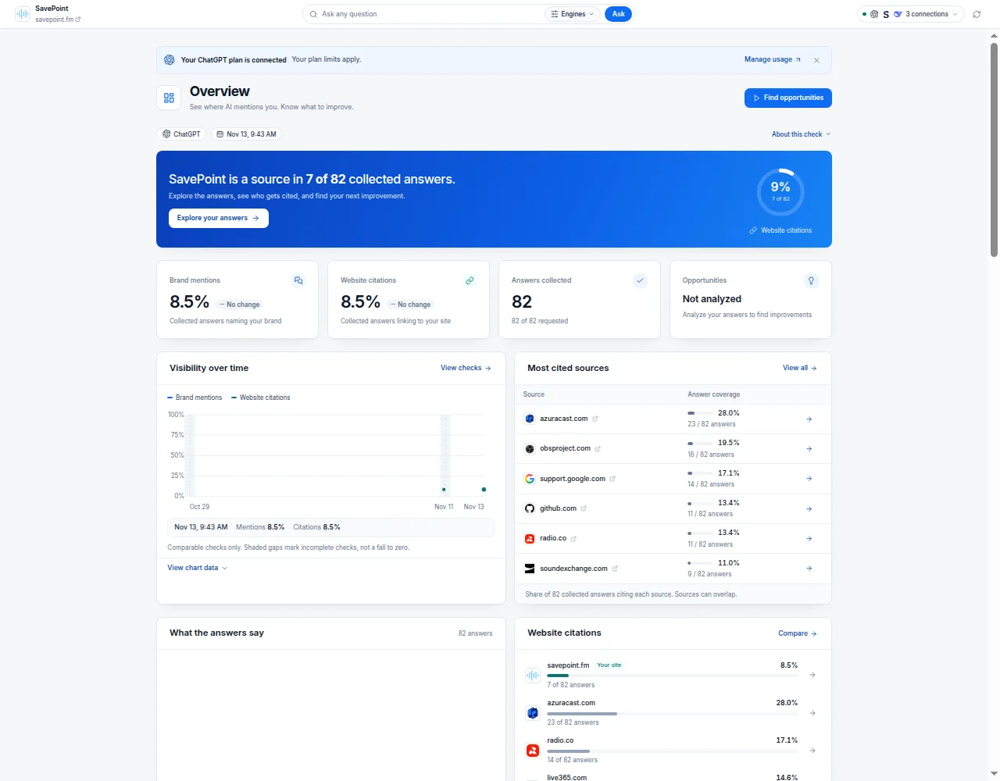{full}

Visibility takes that view further. It shows results over time and question by question. You can see where the brand appeared and where the website received a link. A single check is a point on the chart, not a trend.

Responses is where you read the collected answers in full. Filters separate answers that cite the website, name the brand without a citation, or do neither. Reading the text also helps you spot an unclear match when a brand name has another common meaning.

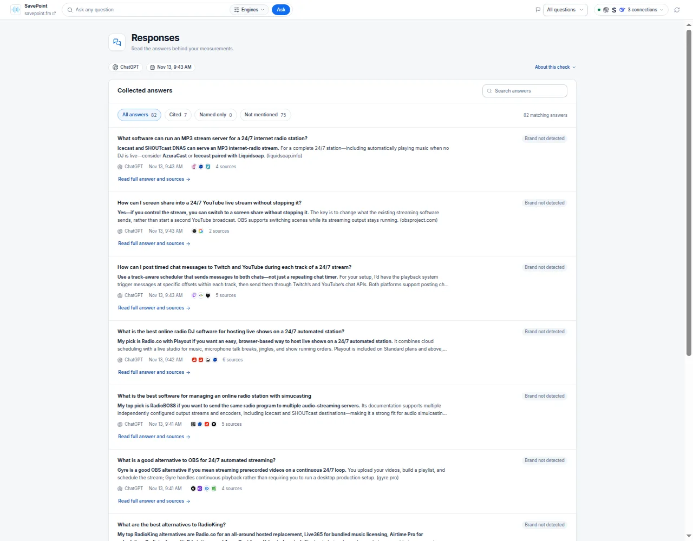{full}

Sources lists the websites those answers linked to. It lets you inspect the pages behind the citations instead of relying on a summary. Reported search results and citations remain distinct. A page that an engine found does not automatically receive citation credit.

Competitors compares citation coverage for the tracked website and selected other websites. These comparisons count links in the same collected answers. They do not measure market share. You review suggested websites before adding them as competitors.

Scans offers AI visibility checks and optional Website health checks. The health scan examines page titles, descriptions, headings and instructions that control search indexing. It also checks structured data, which is page information written in a format machines can read. A missing description is a page finding, not proof that AI assistants are ignoring the website.

Opportunities uses collected evidence to suggest page updates, new resources and website changes. Content supports research, briefs, drafts and review. Sources and factual review notes stay with the draft. A person still needs to check claims before publishing.

Reports exports an evidence and improvement report as Markdown, a plain-text writing format, or for printing. It also offers a portable project copy. Project exports include saved tracked work and drafts, but not provider credentials or one-off Ask history.

## OpenGEO Ask for one-off comparisons

Ask lets you query multiple LLMs at once. An LLM, or large language model, is the kind of AI model that writes these answers. You enter one question, select available engines and compare their replies without starting a full visibility check.

Each answer keeps its sources, reported searches and collection details. Ask also shows whether the answer mentioned the brand or cited the website. A tracking button adds a useful question to future checks.

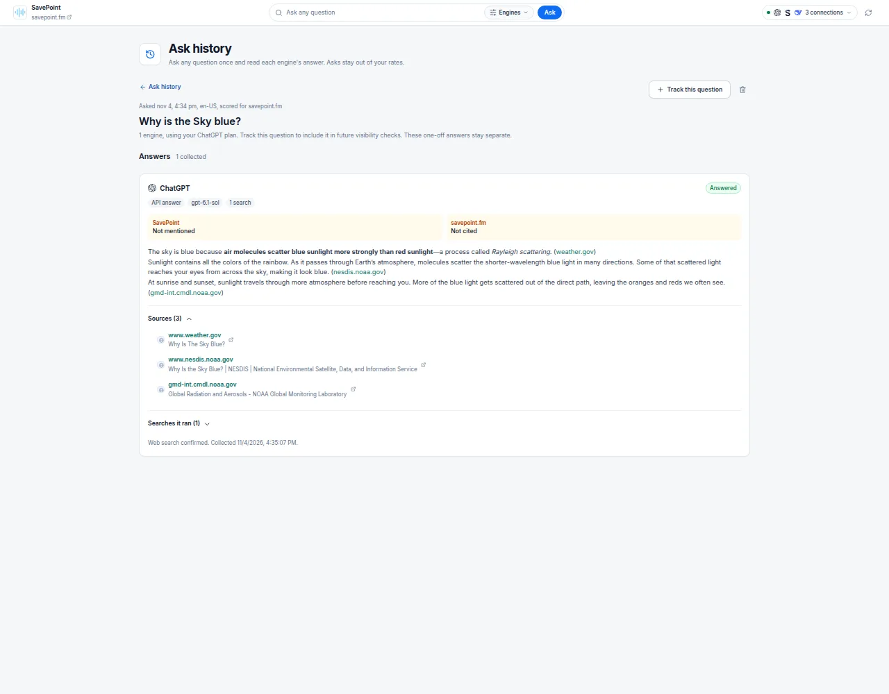{full}

One-off answers stay in Ask history. They do not enter the project's tracked rates, trends, Responses or Sources. Tracking the question affects future checks. It does not move the earlier Ask answers into those measurements.

This separation lets you try a question without changing the consistent set used to compare results over time.

## Connections supported by OpenGEO

Settings shows which services are connected and which need setup. An API is a way for programs to communicate. An API key is a private credential that lets an app use a service through your account. Some connections need one; ChatGPT uses an eligible subscription instead.[^conn]

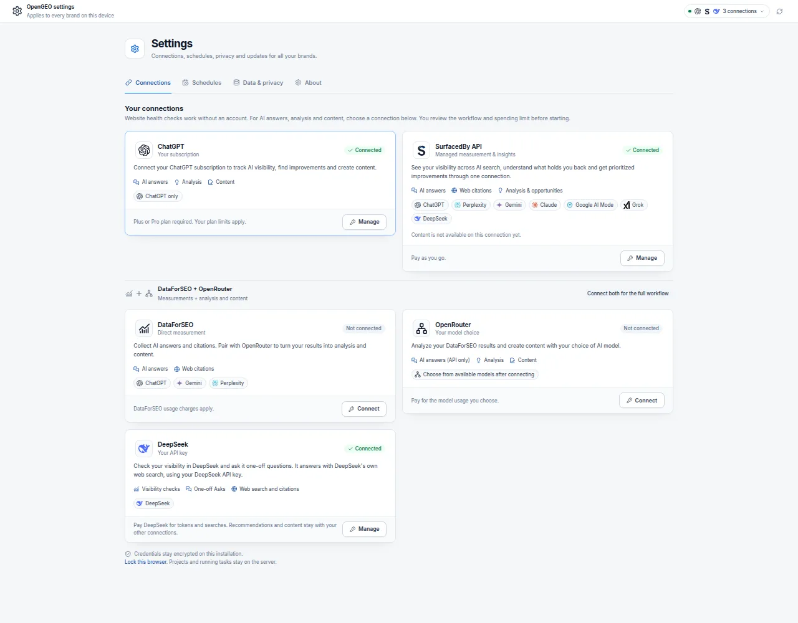{full}

The supported connections have different jobs:

- **ChatGPT** supports answer checks, analysis, question suggestions and content. It needs an eligible subscription and account permissions, with no separate API key. Plan limits apply.
- **OpenRouter** offers a choice of models for answers, analysis and content. Its answers use no live web search. OpenRouter bills model usage.
- **DataForSEO with OpenRouter** separates answer collection from analysis and content. DataForSEO collects ChatGPT, Gemini and Perplexity answers. Both services charge for their work.
- **The SurfacedBy API** offers managed operations supported by the connected account and server. It can reach ChatGPT, Perplexity, Gemini, Claude, Google AI Mode, Grok and DeepSeek. Available engines can differ between full checks and Ask.
- **DeepSeek** connects with your own key, new in beta.7. It supports visibility checks, schedules and Ask. It collects answers; analysis and content remain with other eligible connections.

Readers exploring how to show up in Claude, Gemini, Grok, DeepSeek and Perplexity answers need to choose a connection that reaches those engines. OpenGEO measures the answers available through that connection.

Paid work requires spending approval where applicable. Expired access, service limits or uncertain paid requests can pause work with progress preserved. OpenGEO never silently switches to another paid provider. A budget cannot reverse a charge already incurred, and DataForSEO's actual charge can exceed its estimate.

## The OpenGEO MCP server for SEO workflows

An MCP server is a bridge that lets an AI assistant use an app's tools through Model Context Protocol, a shared communication format. OpenGEO's MCP server lets an AI agent, software that can call tools to complete tasks, read projects and request work.[^dev]

Version 0.1.0-beta.7 exposes twelve tools, grouped here by job:[^release]

- **Read projects:** `list_projects` lists local projects. `read_workspace` reads saved evidence, opportunities and drafts.
- **Start work:** `start_audit` checks public pages without a paid provider. `start_workflow` starts a selected provider workflow with an explicitly approved budget.
- **Inspect and control work:** `read_job` reads status. `preview_resume` shows saved spending limits and uncertain requests. `resume_workflow` continues after explicit review. `cancel_workflow` stops local work and requests supported remote cancellation.
- **Ask questions:** `list_ask_engines` lists availability and pricing. `estimate_ask` estimates without running. `ask_engines` asks selected engines once. `read_ask` reads answers, citations, searches and cost.

Paid work pauses for review when approval is needed or a request has an uncertain outcome. The server does not substitute providers. Cancellation can leave completed work billable, so the saved receipt still needs review.

The configuration below reaches a server over SSH, an encrypted remote connection, and runs OpenGEO inside Docker. Docker packages an app and its required software into an isolated container.

```json
{
  "mcpServers": {
    "opengeo": {
      "command": "ssh",
      "args": [
        "my-server",
        "docker", "exec", "-i",
        "opengeo",
        "node", "dist-server/mcp.js"
      ]
    }
  }
}
```

A desktop or local install runs `node dist-server/mcp.js` instead.

In a read-only example run, Claude Code could use only `list_projects` and `read_workspace`; it reported the example project's tracked question count and latest ChatGPT results, matching Overview. The workspace reply was large, so the agent saved it to a file and read the parts it needed.

## Installing OpenGEO and keeping data local

OpenGEO is a public beta. Desktop downloads are available for Windows and for Mac computers with Apple or Intel processors. The desktop app includes the software needed to run it. Linux users and server operators can use Docker or run from source code.[^install]

Windows beta builds are unsigned. Mac builds do not have Apple's publisher verification or notarization, so either system may warn or block installation. Follow the installation guide rather than disabling security protections.

A self-hosted AI visibility dashboard runs on your own computer or server instead of a hosted service. OpenGEO stores projects, evidence, drafts and progress in SQLite, a local database file. Credentials are encrypted separately and excluded from project exports. Connected services receive the inputs needed for requested work.[^privacy]

Optional usage sharing is preselected during setup. You can uncheck it before finishing or turn it off in Settings under Data & privacy. It shares activity counts and app details, not websites, prompts, answers or credentials. Turning it off does not change features or output quality.

## Contributing to OpenGEO

OpenGEO welcomes bug reports, documentation fixes, accessibility improvements and code contributions. Accessibility work helps people with different needs use the app.

[Open an issue](https://github.com/surfacedby/OpenGEO/issues) with the app version, operating system, steps to reproduce the problem and expected result. Remove credentials, private project data and account screenshots first.

For a substantial feature, describe the user problem before implementing it. Keep changes focused and explain how they were tested. Code contributors should follow the development guide and run the required tests and build.

Report security problems privately through the [security policy](https://github.com/surfacedby/OpenGEO/blob/master/SECURITY.md), rather than opening a public issue.

## SurfacedBy and hosted AI visibility monitoring

SurfacedBy maintains OpenGEO and also offers a hosted AI visibility service. The hosted service monitors supported consumer AI platforms on a schedule. It adds citation tracking, competitor comparisons and opportunities ranked by impact and effort.[^home]

It also offers AI traffic tracking and an engagement queue that holds suggested replies for approval. Its free AI visibility check covers ChatGPT, Perplexity and Gemini without requiring a credit card.

OpenGEO can keep local projects and exports without a managed account. Connecting the SurfacedBy API adds the operations available through that account.

```button primary
Try the free SurfacedBy AI visibility check
https://gbti.network/outbound/surfacedby
```

## OpenGEO screenshot gallery

These screens continue the tour through the example project. They show question management, evidence, website checks and the places where improvements take shape.

Prompts organizes tracked questions and groups them by topic.

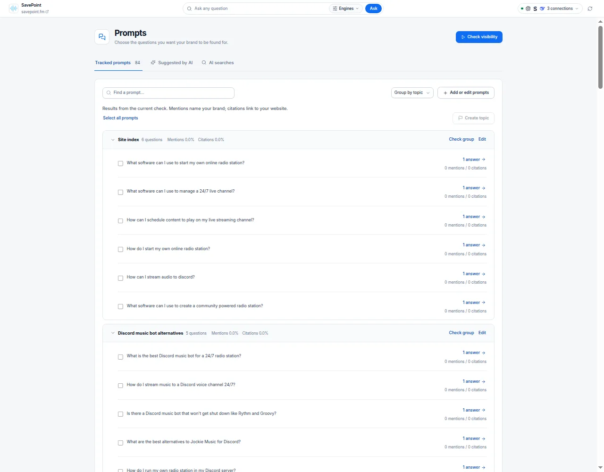{full}

Visibility shows changes over time and results for each question.

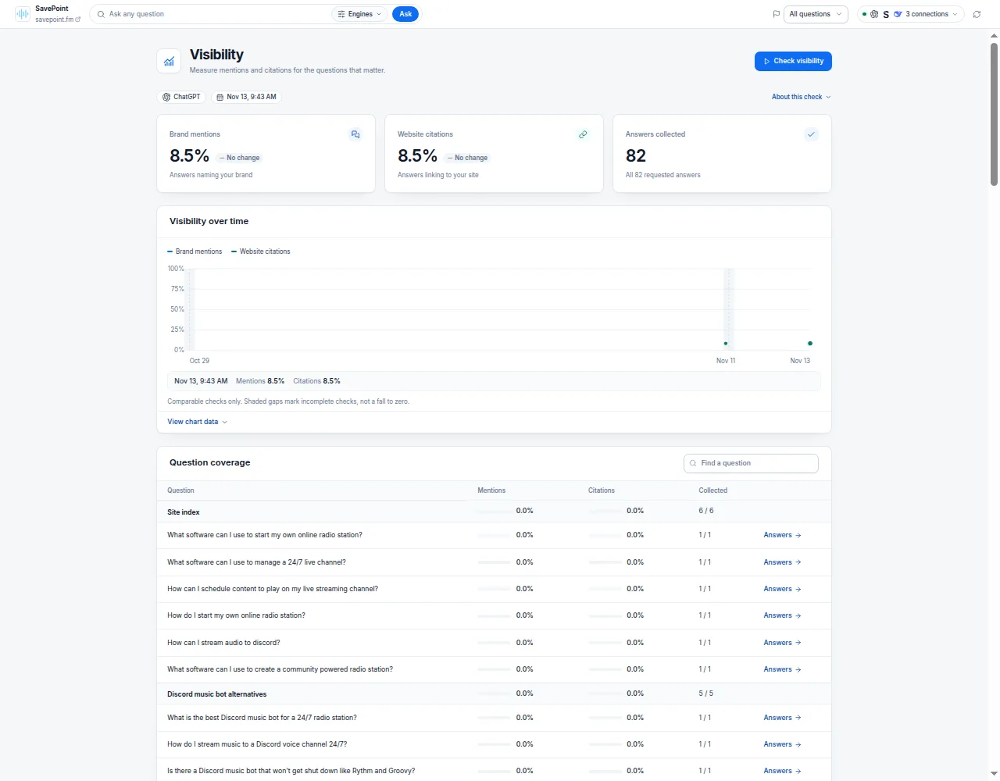{full}

Sources lists the websites linked from collected answers.

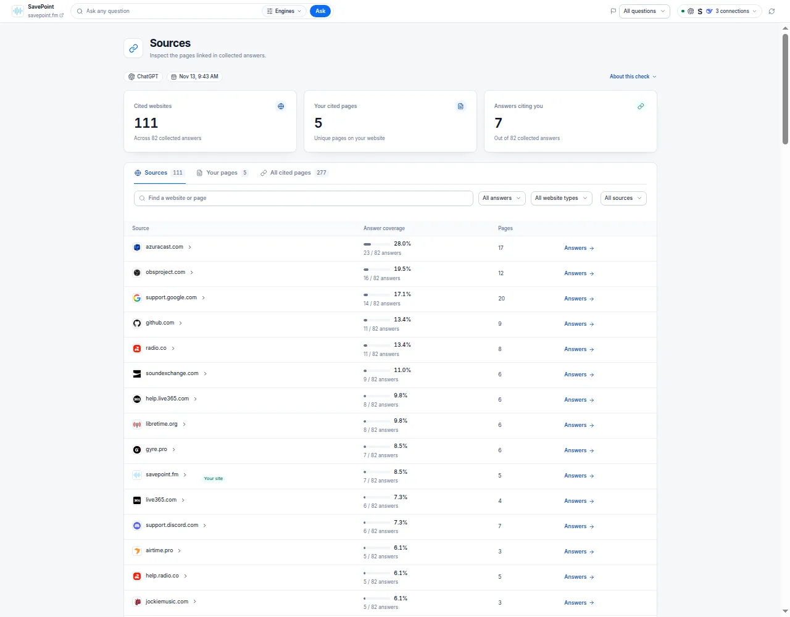{full}

Competitors compares citation coverage across selected websites.

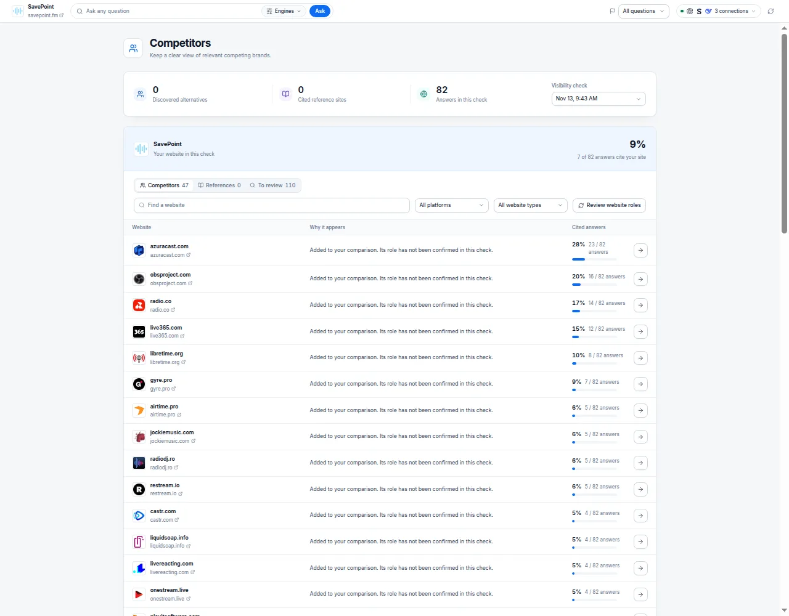{full}

Scans separates AI visibility checks from website health checks.

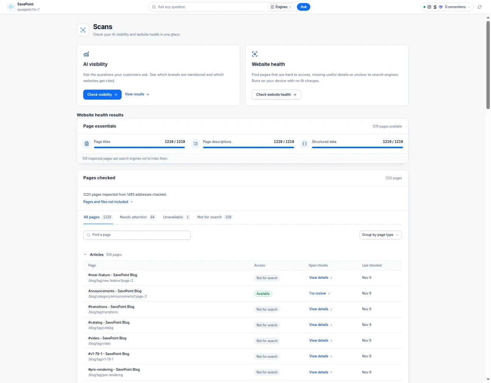{full}

Reports provides evidence reports and portable project exports.

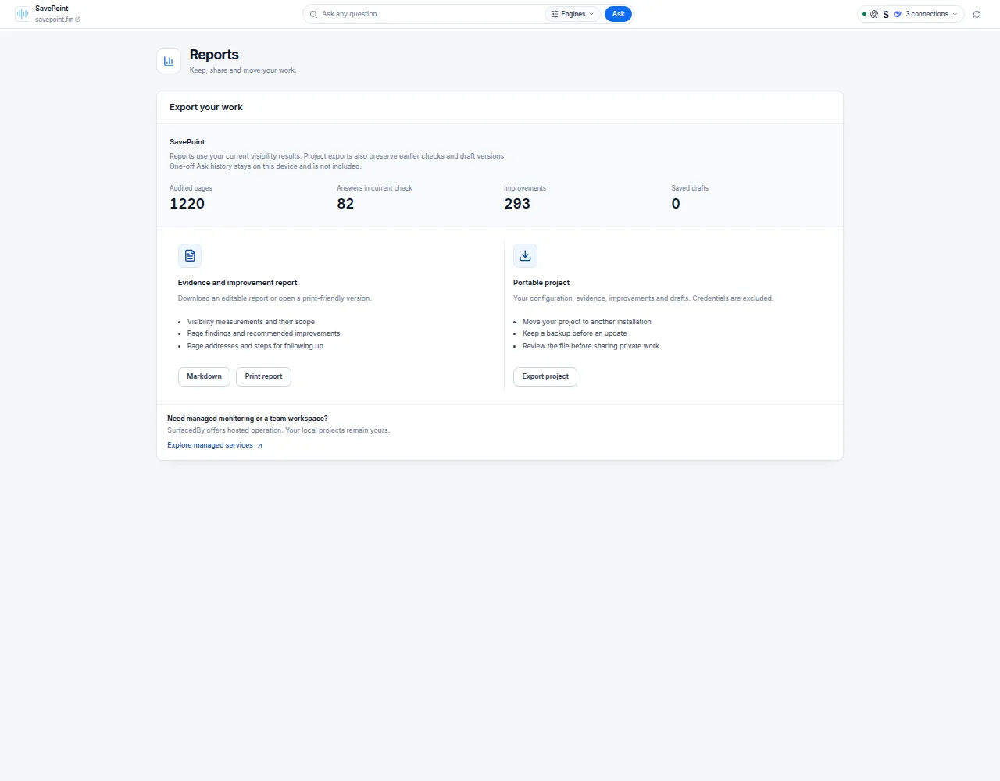{full}

Ask history keeps earlier one-off questions available to read.

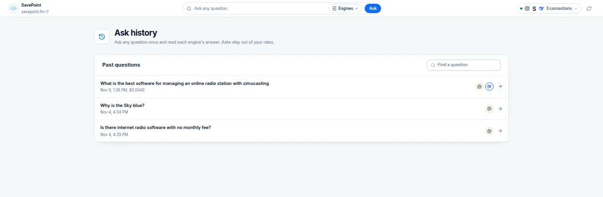{full}

Opportunities starts the process of finding evidence-supported improvements.

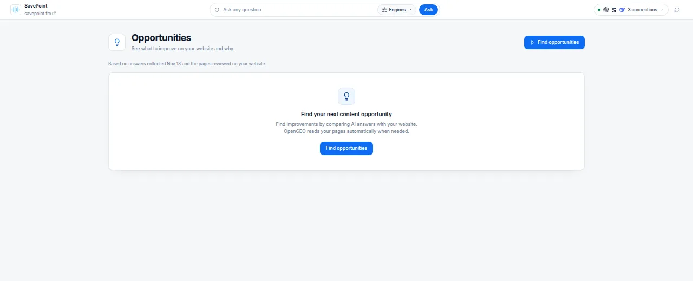{full}

Content provides a place to research, write and review drafts.

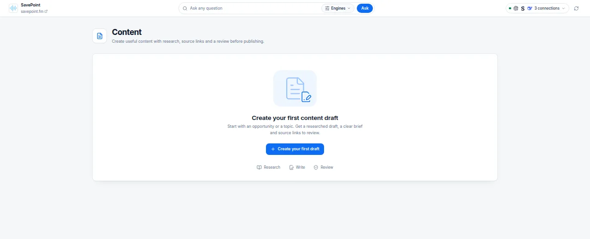{full}

[^opengeo]: [OpenGEO on GitHub](https://github.com/surfacedby/OpenGEO): what it does, that it is maintained by SurfacedBy, and its MIT licence. Read 16 November 2026.

[^method]: [OpenGEO: How measurements work](https://github.com/surfacedby/OpenGEO/blob/master/docs/methodology.md): mention rate, citation rate and how citations are read.

[^conn]: [OpenGEO: Connections and costs](https://github.com/surfacedby/OpenGEO/blob/master/docs/connections.md): ChatGPT, OpenRouter, DataForSEO, SurfacedBy and DeepSeek, with spending approval.

[^dev]: [OpenGEO: Development](https://github.com/surfacedby/OpenGEO/blob/master/docs/development.md): the command line and the MCP server.

[^install]: [OpenGEO: Installation and self-hosting](https://github.com/surfacedby/OpenGEO/blob/master/docs/distribution.md): downloads, Docker, updates and backups.

[^privacy]: [OpenGEO: Privacy](https://github.com/surfacedby/OpenGEO/blob/master/docs/privacy.md): local storage, credentials and optional usage sharing.

[^release]: [OpenGEO 0.1.0-beta.7 release notes](https://github.com/surfacedby/OpenGEO/releases/tag/v0.1.0-beta.7), 13 November 2026.

[^home]: [SurfacedBy](/outbound/surfacedby): the hosted service, the platforms it monitors and its free AI visibility check. Read 4 November 2026.

[^example]: The screenshots show OpenGEO tracking savepoint.fm, the website of SavePoint Station Manager, on 16 November 2026, used with its owner's permission. The cover image shows the night side of Earth from space (photo by Zelch Csaba on Pexels) with the Anthropic, OpenAI, Grok, DeepSeek and Gemini logos beneath the title Introducing OpenGEO.
