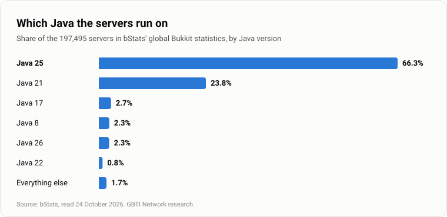

This article shows which versions Minecraft Java servers run and how that differs between server software, including how soon each one shipped the newest versions. It also shows which versions Fabric, Forge, NeoForge and Quilt players and servers download mods for, how the most used version has changed since July 2018, and which Java runtimes and proxies servers run.

The data comes from these sources:

- [bStats global charts](https://bstats.org/global/bukkit): the share of servers on each Minecraft version, each server software and each Java runtime, read in full on the first, fourth and last day of the week from 17 October 2026 to 24 October 2026, and every three hours in between.
- [bStats per-software pages](https://bstats.org/plugin/server-implementation/paper/580): the versions on each server software (Paper's page is the one linked; the others follow the same pattern).
- [bStats proxy charts for Velocity](https://bstats.org/global/velocity) and [BungeeCord](https://bstats.org/global/bungeecord): the proxy counts.
- [Modrinth API](https://api.modrinth.com/v2): one week of downloads, 17 October 2026 to 24 October 2026, for the 500 most downloaded mods of each loader, split by Minecraft version.
- [CurseForge API](https://api.curseforge.com): each loader's total downloads for the same week.
- [Internet Archive](https://web.archive.org/): archived copies of the bStats version chart since July 2018, for the most used version over time.
- The build lists of [PaperMC](https://fill.papermc.io/v3/projects/paper), [Purpur](https://api.purpurmc.org/v2/purpur) and [Leaf](https://api.leafmc.one/v2/projects/leaf): when each one shipped a build for each new Minecraft version.
- [Mojang's version manifest](https://piston-meta.mojang.com/mc/game/version_manifest_v2.json): the release dates and the list of every Java release. A version string that matched no release, such as a mod's own version or a typo, was left out of the shares.

The article starts with which versions servers run, including Mojang's year-based version numbers. Next is the version mix on Paper, Purpur and the forks, with when each one shipped the new versions and the Forge and NeoForge hybrids. After that come the versions Fabric, Forge, NeoForge and Quilt players download, the most used version since July 2018 with the servers still on 1.8, and Java runtimes and proxies. It ends with how we measured (the full method sits behind a toggle there), short answers to three common questions, and the list of sources.

## Which Minecraft versions servers run

On 24 October 2026, 26.3 was the most used version of Minecraft Java: it ran on 23.38% of the 196,558 servers that reported a Java release to bStats. 1.21.11 and 26.2 were within 0.32 percentage points, at 23.12% and 23.06%. 26.2 had led 50 of the week's 55 readings from 17 October 2026 to 24 October 2026 before 26.3 moved ahead on the last day.

Three versions together hold 69.55%. Just over half run one of the new year-based versions (53.67%), the 1.21 line still has 36.46%, and 1.20.1 and 1.8.8 still hold 2.20% and 2.15%.

Beyond the ten most used versions, the other 58 releases share 7.99%. About 150,000 Bukkit-family servers reported in October 2023, and about 188,000 in October 2026.


### Mojang's year-based version numbers

Mojang [announced](https://www.minecraft.net/en-us/article/minecraft-new-version-numbering-system) on 2 December 2025 that both Java and Bedrock editions would move to year-based version numbers: the year first, then the release number, then the hotfix number. Java writes the hotfix as a separate third number, whereas Bedrock counts upwards from the release number itself. The last version to start with "1." was 1.21.11, according to the [Minecraft Wiki](https://minecraft.wiki/w/Version_formats).

## The version mix on Paper, Purpur and the forks

bStats classifies 190,740 servers by software. Paper runs on 74.39% of them, Purpur on 9.05%, Spigot on 6.30%, Leaf on 2.31%, UniverseSpigot on 1.10%, [Arclight](https://github.com/IzzelAliz/Arclight) on 0.80%, and Folia on 0.71%. Another 2.77% report a name outside bStats' list.


Paper leans newest: 63.58% of its servers run a year-based version. The forks lean older. Version 1.21.11 leads on Leaf (51.14%), UniverseSpigot (42.42%) and Folia (33.47%), and Folia has another 22.64% on 26.1.2.

![Which Minecraft Java versions servers run, by server software, read 24 October 2026. All servers (196,558 servers): 26.3 23.4%, 26.2 23.1%, 26.1.x 7.2%, 1.21.11 23.1%, Older versions 23.2%. Paper (178,346 servers): 26.3 30.5%, 26.2 25.4%, 26.1.x 7.7%, 1.21.11 19.8%, Older versions 16.6%. Purpur (20,870 servers): 26.3 22.6%, 26.2 23.3%, 26.1.x 7.8%, 1.21.11 24.8%, Older versions 21.5%. Leaf (4,703 servers): 26.3 8.9%, 26.2 22.0%, 26.1.x 3.1%, 1.21.11 51.1%, Older versions 14.8%. UniverseSpigot (2,442 servers): 26.3 7.7%, 26.2 23.5%, 26.1.x 3.5%, 1.21.11 42.4%, Older versions 22.9%. Folia (2,160 servers): 26.3 11.8%, 26.2 25.6%, 26.1.x 22.6%, 1.21.11 33.5%, Older versions 6.5%. Mohist (1,189 servers): 26.3 0.0%, 26.2 0.0%, 26.1.x 0.0%, 1.21.11 0.0%, Older versions 100.0%.](./images/version-mix-by-software.svg)

### When each server software shipped the new versions

The table lists the days from Mojang's release to each software's first build and first stable build, for 26.1.2, 26.2 and 26.3. Paper marked 26.3 stable 26 days after Mojang's release. Folia's first 26.3 build, an alpha, arrived 29 days after. Every Leaf 26.x build is still marked experimental, and Purpur's builds carry a build result rather than a release channel, so Purpur does not mark any build stable.

<!-- sort: off -->
| Version | Server software | First build | First stable build |
|---|---|---|---|
| 26.1.2 | Paper | 2.1 days (alpha) | 21.9 days |
| 26.1.2 | Purpur | 3.5 days (build result only) | no release channel |
| 26.1.2 | Leaf | 67.4 days (experimental) | none yet |
| 26.1.2 | Folia | 26.9 days (stable) | 26.9 days |
| 26.2 | Paper | 0.1 days (alpha) | 40.2 days |
| 26.2 | Purpur | 1.6 days (build result only) | no release channel |
| 26.2 | Leaf | 1.3 days (experimental) | none yet |
| 26.2 | Folia | 41.8 days (beta) | none yet |
| 26.3 | Paper | 0.2 days (alpha) | 26.2 days |
| 26.3 | Purpur | 0.6 days (build result only) | no release channel |
| 26.3 | Leaf | 17 days (experimental) | none yet |
| 26.3 | Folia | 29.4 days (alpha) | none yet |

*Days from Mojang's release. Build lists read 17 October 2026.*

PaperMC lists only 26.3 and 26.2 as supported, and it ended support for 1.21.11 on 15 June 2026, yet about one Paper server in five (19.80%) still runs it.

### Forge and NeoForge hybrids

Mohist, Youer, Magma, Magma Maintained, Ketting and LoliServer each sit mostly on one version.

| Hybrid | Servers on a release | Main version | Share on it |
|---|---|---|---|
| Mohist | 1,189 | 1.20.1 | 69.64% |
| Youer | 664 | 1.21.1 | 90.21% |
| Magma | 26 | 1.12.2 | 80.77% |
| Magma Maintained | 47 | 1.12.2 | 85.11% |
| Ketting | 40 | 1.20.1 | 97.50% |
| LoliServer | 35 | 1.16.5 | 88.57% |

*bStats, read 24 October 2026. Mohist and Youer are read from their own version strings.*

Arclight (0.80% of servers), the largest hybrid, has no bStats page of its own. Spigot has no version page of its own, so it shows up only in the totals.

## What Fabric, Forge, NeoForge and Quilt players download

Fabric, Forge, NeoForge and Quilt servers do not report their Minecraft version to any statistics service, so bStats cannot count them the way it counts Paper servers. We measured the closest thing available: one week of mod downloads from 17 October 2026 to 24 October 2026 for each loader, counting the 500 most downloaded mods on Modrinth. Players and servers both download mods, so the numbers describe both together.


Only the first place in each loader is firm. A release that lists several Minecraft versions has its downloads split evenly across them; counting only releases that list a single version keeps each loader's leader but reorders the places below it. Quilt's order also rests on this week's updates: counting only releases that existed before the week, 1.20.1 edges ahead of 26.3.

### Paper and Fabric side by side

The chart puts the two answers next to each other. Paper's panel is a share of servers, and Fabric's is a share of one week's mod downloads.


### Fabric API by version

Fabric's own [documentation](https://docs.fabricmc.net/players/installing-mods) says the majority of mods require Fabric API, so its download numbers are the clearest single sign of where Fabric players and servers are.

| Minecraft version | Weekly downloads | Share of the week |
|---|---|---|
| 26.3 | 2,745,580 | 37.96% |
| 1.21.11 | 1,292,528 | 17.87% |
| 26.2 | 837,048 | 11.57% |
| 1.21.1 | 802,316 | 11.09% |
| 1.20.1 | 562,513 | 7.78% |
| 1.21.4 | 145,301 | 2.01% |

*Fabric API on Modrinth, 17 October 2026 to 24 October 2026.*

### What the loaders' own teams expect

Forge [treats](https://forums.minecraftforge.net/topic/154387-forge-474-minecraft-1201/) 1.20.1 as its long-lived version, and NeoForge [treats](https://neoforged.net/news/21.2release/) 1.21.1 that way. In March 2026 NeoForge [said](https://neoforged.net/news/26.1release/) 26.1 would likely replace 1.21.1 as the next stable modding version. This week 26.x versions took 13.86% of NeoForge's Modrinth downloads against 39.10% for 1.21.1, so that replacement has not happened yet.

### How many downloads each loader reaches

A mod built for several loaders counts in each loader's row, so the rows are never added up or read as shares. CurseForge appears only here, because its per-version download counts did not update during the week.

| Loader | Modrinth, weekly downloads | CurseForge, weekly downloads |
|---|---|---|
| Fabric | 263,147,623 | 241,759,579 |
| Forge | 206,867,186 | 275,835,894 |
| NeoForge | 237,817,761 | 289,926,225 |
| Quilt | 168,295,563 | 124,002,301 |

*The 500 most downloaded mods per loader, 17 October 2026 to 24 October 2026. A mod built for several loaders counts in each row, so the rows do not add up.*

## The most used version since 2018

The Internet Archive holds copies of the bStats global version chart going back to July 2018. We found 15 versions that led in those copies, starting with 1.12.2 at 49.40% in July 2018. The record share is 51.83%, held by 1.20.1 in September 2023. 1.21.11 reached 48.05% in March 2026.

The longest run belongs to 1.21.4, which led in nine copies in a row from February 2025 to August 2025. Leaders have held anywhere from 19.61% to 51.83%, so today's 23.38% is within the usual range. The archive has no copies from August 2018 to July 2020, and the chart notes the gap. Months with no archived copy may hide others.

![The most used Minecraft Java version on servers reporting to bStats, at each archived reading from 2018 to 2026 and our reading of 24 October 2026, with its highest share while it led: 1.12.2 (Jul 2018) 49.4%; 1.16.1 (Aug 2020 to Sep 2020) 39.8%; 1.16.5 (Feb 2021) 38.7%; 1.17.1 (Sep 2021) 45.2%; 1.18.2 (Apr 2022 to Jun 2022) 45.9%; 1.19 (Jul 2022 to Aug 2022) 34.0%; 1.19.2 (Oct 2022 to Nov 2022) 45.9%; 1.19.3 (Feb 2023 to Mar 2023) 38.0%; 1.20.1 (Jul 2023 to Jan 2024) 51.8%; 1.20.4 (Mar 2024 to Jun 2024) 42.0%; 1.21 (Aug 2024 to Sep 2024) 34.2%; 1.21.1 (Sep 2024) 24.2%; 1.21.4 (Feb 2025 to Aug 2025) 40.2%; 1.21.8 (Oct 2025 to Nov 2025) 25.8%; 1.21.11 (Mar 2026) 48.0%; 26.3 (our reading, Oct 2026) 23.4%. The archive has no copies from August 2018 to July 2020.](./images/most-used-version-since-2018.svg)

### Servers still on 1.8

In July 2018, servers on any 1.8 release accounted for 31.40% of servers. That share is now 2.18%. Version 1.9 added an attack cooldown, according to Mojang's [release notes](https://web.archive.org/web/20161218214458/http://mojang.com/2016/02/minecraft-19-combat-update/). Hypixel [said](https://hypixel.net/threads/hypixel-now-supports-minecraft-version-1-13.1698790/) in 2018 that it was still optimized for 1.8.9.

The sources do not state why servers stayed on 1.8.


## Java runtimes and proxies

Java 25 runs 66.34% of servers and Java 21 runs 23.78%. Every year-based version needs Java 25 ([Mojang](https://www.minecraft.net/en-us/article/minecraft-java-edition-26-1)), and more servers run Java 25 than run a year-based version (53.67%), so some servers still on 1.21 already use Java 25.



Velocity passed BungeeCord in July 2024, by monthly average. This month Velocity has 13,391 proxies to BungeeCord's 2,115, counting on both sides only the proxies that run at least one bStats plugin.


## How we measured

We measured Bukkit-family servers through bStats, which aggregates metrics from every server running a plugin that reports to it. We read the global version, software, Java and proxy charts, plus the per-software version pages for implementations that publish them. We took full readings on the first, fourth and last day of the week from 17 October 2026 to 24 October 2026, and a shorter reading every three hours in between. For Fabric, Forge, NeoForge and Quilt we counted downloads of the 500 most downloaded mods on Modrinth during the same week. CurseForge gives weekly totals per loader from its API, because its per-version counters barely moved.

```reveal Show the full method
---
bStats numbers count servers that run at least one plugin with bStats enabled. Each server submits once every 30 minutes to the global charts, and the same server appears once no matter how many bStats plugins it runs. bStats caps submissions at 16 servers per IP address each half hour on the global charts, and at 8 per IP on per-software pages. Servers behind a single address that run more than that are undercounted.

We took full readings on the first, fourth and last day of the week from 17 October 2026 to 24 October 2026: the version, software, Java runtime and proxy charts, and every per-software version page that bStats lists. Every three hours in between, a shorter reading recorded the global version and software charts and the version charts of Paper, Purpur, Leaf, UniverseSpigot and Folia. Three of those were missed on 18 October, when the machine taking them was off.

For mod loaders we tallied downloads on Modrinth for the 500 most downloaded mods of each loader from 17 October 2026 to 24 October 2026. Those pinned mods covered between 69.51% and 91.71% of each loader's total Modrinth downloads that week, measured by comparing the pinned set against the full API list. A mod built for multiple loaders counts toward each loader's total. Modrinth counts one download per address per project in any 15 seconds, and at most six per address per project in six hours.

Version strings were cleaned against Mojang's version manifest. Strings that matched a known Java release were grouped under that release. Anything else, such as mod version strings, git builds and typos, was counted as other and left out of the shares.

CurseForge per-version counters did not move reliably during the week. The per-file counters moved only 1.8% as much as the project counters, so the article uses CurseForge's weekly loader totals instead of per-version shares.

The limits of this measurement are:
- Servers with bStats switched off are missing entirely.
- ViaVersion and ViaBackwards allow players to join on a different client version than the server runs, so the server version chart does not necessarily match the versions players use.
- Proxy counts include only those proxies that run at least one bStats plugin.
```

## Short answers about Minecraft Java versions

**What is the latest version of Minecraft Java?** The latest release is 26.3. Mojang shipped it on 15 September 2026.

**Which versions do Fabric and Forge players use most?** On Modrinth this week, Fabric's most downloaded version was 26.3. Forge's was 1.20.1.

**Why do some servers still run 1.8?** The sources do not state a reason. Hypixel said in 2018 that it was still optimized for 1.8.9, but that does not explain why other servers stayed.

## Sources

- [bStats global Bukkit charts](https://bstats.org/global/bukkit): server versions, software, Java runtimes and historical counts.
- [bStats Velocity](https://bstats.org/global/velocity) and [BungeeCord](https://bstats.org/global/bungeecord) charts: proxy counts.
- [bStats per-software pages](https://bstats.org/plugin/server-implementation/paper/580): versions on each server software (Paper's page shown; the others follow the same address pattern).
- [bStats software API](https://bstats.org/api/v2/software): per-IP submission caps.
- [Internet Archive](https://web.archive.org/): archived bStats charts from 2018 to 2026.
- [Mojang version manifest](https://piston-meta.mojang.com/mc/game/version_manifest_v2.json): Java release dates and strings.
- [Mojang new-version numbering](https://www.minecraft.net/en-us/article/minecraft-new-version-numbering-system): the year-based scheme and Java's hotfix format.
- [Minecraft Wiki version formats](https://minecraft.wiki/w/Version_formats): 1.21.11 as the last "1." release.
- [PaperMC downloads service](https://fill.papermc.io/v3/projects/paper): build dates and support status for Paper and Folia.
- [Purpur downloads API](https://api.purpurmc.org/v2/purpur): Purpur build dates.
- [Leaf downloads API](https://api.leafmc.one/v2/projects/leaf): Leaf build dates and release channels.
- [Mojang 26.1 release notes](https://www.minecraft.net/en-us/article/minecraft-java-edition-26-1): Java 25 requirement.
- [Mojang 1.9 combat update](https://web.archive.org/web/20161218214458/http://mojang.com/2016/02/minecraft-19-combat-update/): attack cooldown.
- [Hypixel 1.8.9 statement](https://hypixel.net/threads/hypixel-now-supports-minecraft-version-1-13.1698790/): optimization for 1.8.9.
- [ViaVersion](https://github.com/ViaVersion/ViaVersion): version proxying between client and server.
- [Modrinth API](https://api.modrinth.com/v2): mod downloads by loader and version.
- [Modrinth Labrinth server code](https://github.com/modrinth/code): download counting rules.
- [CurseForge API](https://api.curseforge.com): weekly loader download totals.
- [Forge 1.20.1 policy](https://forums.minecraftforge.net/topic/154387-forge-474-minecraft-1201/): long-lived version plan.
- [NeoForge 21.2 release](https://neoforged.net/news/21.2release/): 1.21.1 as the recommended maintenance version.
- [NeoForge 26.1 release](https://neoforged.net/news/26.1release/): 26.1 as the expected next stable version.
- [Fabric API docs](https://docs.fabricmc.net/players/installing-mods): majority of mods require Fabric API.
- [Arclight](https://github.com/IzzelAliz/Arclight): hybrid server implementation.
