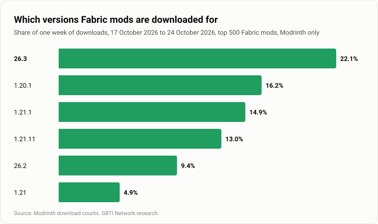
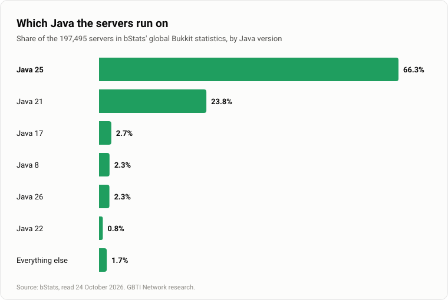

In this article we take a look at the most played version of Minecraft Java in 2026.

When a Minecraft Java player joins a custom server, the player has to run the Minecraft version that the server supports.

We wanted to build an understanding of not only which Minecraft Java version was most being played in 2026, but also what type of server software was being used since there are many unique frameworks being used to run Minecraft servers.

Inside this article we will ask the following questions given the data currently available on the internet:

- What is the most used version of Minecraft Java?
- What version do most Minecraft servers use?
- What is the most popular Minecraft version for mods?
- Is Fabric or Forge more popular?

## What is the most used version of Minecraft Java?


Averaged across the five kinds of server, 1.20.1 is the most used version of Minecraft Java, at 24.64%. It is the most downloaded version for Forge mods, with 66.30% of their downloads, and the second for Fabric, NeoForge and Quilt mods. 26.3 comes next at 15.01%, and it is the top version on Paper-family servers and for Fabric and Quilt mods.

```reveal Show how the average is calculated
---
For each version, we add up its share on each of the five kinds of server, then divide the total by five:

`average = (Paper family + Fabric + Forge + NeoForge + Quilt) ÷ 5`

For 1.20.1: (2.20% + 16.19% + 66.30% + 21.71% + 16.80%) ÷ 5 = 123.20% ÷ 5 = 24.64%.

The Paper-family figure is a share of servers and the other four are shares of one week of mod downloads. Each kind counts the same, however many servers or downloads stand behind it, and each kind's shares add up to 100%, so the averages do too. The next section shows each kind on its own.
```

## What version do most Minecraft servers use?

![The four most used Minecraft Java versions on each kind of server. Paper family (servers, bStats): 26.3 23.4%, 1.21.11 23.1%, 26.2 23.1%, 26.1.2 6.9%. Fabric (mod downloads, Modrinth): 26.3 22.1%, 1.20.1 16.2%, 1.21.1 14.9%, 1.21.11 13.0%. Forge (mod downloads, Modrinth): 1.20.1 66.3%, 1.20 13.0%, 1.19.2 2.3%, 1.20.2 1.8%. NeoForge (mod downloads, Modrinth): 1.21.1 39.1%, 1.20.1 21.7%, 1.21 8.6%, 26.3 8.2%. Quilt (mod downloads, Modrinth): 26.3 20.0%, 1.20.1 16.8%, 1.21.11 12.7%, 1.21.1 10.0%. Servers read 24 October 2026; downloads from 17 October 2026 to 24 October 2026.](./images/most-used-by-kind.svg)

26.3 is the most used version on Paper-family servers, at 23.38%, and the most downloaded version for Fabric and Quilt mods. Forge mods are downloaded most for 1.20.1, and NeoForge mods for 1.21.1.

### How this was gathered

Paper-family servers report their version to bStats[^1]. bStats is the built-in reporting engine that keeps track of global usage, so we were able to collect data on over 196,558 servers. The Paper family is Paper itself, Spigot, which Paper is built on, and the servers built on Paper, such as Purpur, Leaf and Folia.

Fabric, Forge, NeoForge and Quilt servers do not have the same reporting mechanisms, so we had to take a different path to understand version-usage stats by reviewing known statistics of the last week of mod download data publicly available from each platform's 500 most downloaded mods on Modrinth[^2], one of the most popular mod hosting sites.

```callout info
**Did you know?** Mojang [announced](https://www.minecraft.net/en-us/article/minecraft-new-version-numbering-system) on 2 December 2025 that Minecraft would number its versions by year. The first number is the year, the second is the release within that year, and the third is the hotfix, so 26.1.2 is the second hotfix of the first release of 2026. The last version numbered the old way, starting with "1.", was 1.21.11, according to the [Minecraft Wiki](https://minecraft.wiki/w/Version_formats).
```

## What is the most popular Minecraft version for mods?

It depends on the platform. On Modrinth, Fabric and Quilt mods are downloaded most for 26.3, Forge mods for 1.20.1 and NeoForge mods for 1.21.1.

### Fabric servers

Fabric's most downloaded version is 26.3 at 22.14%. The next two are 1.20.1 at 16.19% and 1.21.1 at 14.89%. These are shares of one week of downloads of the 500 most downloaded Fabric mods on Modrinth.



#### Fabric API by version

Fabric API is a library mod that most Fabric mods need, according to Fabric's own documentation[^3], so its downloads are the clearest single sign of which versions Fabric runs on.

| Minecraft version | Weekly downloads | Share of the week |
|---|---|---|
| 26.3 | 2,745,580 | 37.96% |
| 1.21.11 | 1,292,528 | 17.87% |
| 26.2 | 837,048 | 11.57% |
| 1.21.1 | 802,316 | 11.09% |
| 1.20.1 | 562,513 | 7.78% |
| 1.21.4 | 145,301 | 2.01% |

*Fabric API on Modrinth, 17 October 2026 to 24 October 2026.*

## Is Fabric or Forge more popular?

It depends on the site. Fabric mods are downloaded most on Modrinth, ahead of Forge. On CurseForge, NeoForge mods are downloaded most and Forge is second, ahead of Fabric. Quilt is fourth on both. This table gives each platform's total mod downloads for the week on Modrinth and on CurseForge[^4], the two mod sites we measured. A mod made for several platforms counts in each of their rows, so the rows cannot be added together. CurseForge appears only here, because its per-version download counts barely moved during the week.

| Platform | Modrinth, weekly downloads | CurseForge, weekly downloads |
|---|---|---|
| Fabric | 263,147,623 | 241,759,579 |
| Forge | 206,867,186 | 275,835,894 |
| NeoForge | 237,817,761 | 289,926,225 |
| Quilt | 168,295,563 | 124,002,301 |

*The 500 most downloaded mods per platform, 17 October 2026 to 24 October 2026.*


## Version leaders on Paper-family servers since 2018

The oldest Internet Archive[^5] copy of bStats' version chart is from July 2018. Across the archived copies, 15 versions led. 1.21.4 held the top spot longest, leading in nine consecutive copies from February 2025 to August 2025.

Leaders held between 19.61% and 51.83%, putting 26.3's 23.38% within the usual range. The chart marks the archive's gap from August 2018 to July 2020; other missing months may hide versions that led briefly.

![The most used Minecraft Java version on servers reporting to bStats, at each archived reading from 2018 to 2026 and our reading of 24 October 2026, with its highest share while it led: 1.12.2 (Jul 2018) 49.4%; 1.16.1 (Aug 2020 to Sep 2020) 39.8%; 1.16.5 (Feb 2021) 38.7%; 1.17.1 (Sep 2021) 45.2%; 1.18.2 (Apr 2022 to Jun 2022) 45.9%; 1.19 (Jul 2022 to Aug 2022) 34.0%; 1.19.2 (Oct 2022 to Nov 2022) 45.9%; 1.19.3 (Feb 2023 to Mar 2023) 38.0%; 1.20.1 (Jul 2023 to Jan 2024) 51.8%; 1.20.4 (Mar 2024 to Jun 2024) 42.0%; 1.21 (Aug 2024 to Sep 2024) 34.2%; 1.21.1 (Sep 2024) 24.2%; 1.21.4 (Feb 2025 to Aug 2025) 40.2%; 1.21.8 (Oct 2025 to Nov 2025) 25.8%; 1.21.11 (Mar 2026) 48.0%; 26.3 (our reading, Oct 2026) 23.4%. The archive has no copies from August 2018 to July 2020.](./images/most-used-version-since-2018.svg)

## Java runtimes and proxies

Minecraft servers run on Java, the programming language. Of the servers reporting to bStats, 66.34% run Java 25 and 23.78% run Java 21. Every year-based version needs Java 25[^6], and more servers run Java 25 than run a year-based version (53.67%), so some servers still on 1.21 already use Java 25.



A proxy joins several servers into one network that players move between. Velocity passed BungeeCord in July 2024, by monthly average, and in October 2026 Velocity averaged 13,391 proxies to BungeeCord's 2,115, counting only proxies that run at least one bStats plugin.[^7]


## Short answers about Minecraft Java versions

**What is the latest version of Minecraft Java?** The latest release is 26.3. Mojang shipped it on 15 September 2026[^8].

**Which versions do Fabric and Forge players use most?** On Modrinth, in the week we measured, Fabric's most downloaded version was 26.3. Forge's was 1.20.1. NeoForge's was 1.21.1, and Quilt's was 26.3.

**Why do some servers still run 1.8?** The sources do not state a reason. Hypixel[^9] said in 2018 that it was still optimized for 1.8.9, but that does not explain why other servers stayed.

Paper-family servers report their Minecraft versions directly to bStats[^1], a statistics service integrated into Paper. This allows the article to count servers by version. Fabric, Forge, NeoForge and Quilt servers do not provide equivalent reporting, so the article estimates their version usage based on mod download activity for each Minecraft version on Modrinth[^2], with each platform's weekly totals from CurseForge[^4].

[^1]: [bStats global charts](https://bstats.org/global/bukkit): bStats collects usage statistics from Minecraft servers, and its charts give the share of servers on each Minecraft version, server software and Java runtime, read several times a day from 17 October 2026 to 24 October 2026.

[^2]: [Modrinth API](https://api.modrinth.com/v2): one week of downloads, 17 October 2026 to 24 October 2026, for the 500 most downloaded mods of each platform, split by Minecraft version.

[^3]: [Fabric documentation](https://docs.fabricmc.net/players/installing-mods): most Fabric mods need Fabric API installed.

[^4]: [CurseForge API](https://api.curseforge.com): each platform's total downloads for the same week.

[^5]: [Internet Archive](https://web.archive.org/): archived copies of the bStats version chart since July 2018, for the most used version over time.

[^6]: [Mojang 26.1 release notes](https://www.minecraft.net/en-us/article/minecraft-java-edition-26-1): every year-based version needs Java 25.

[^7]: [bStats proxy charts for Velocity](https://bstats.org/global/velocity) and [BungeeCord](https://bstats.org/global/bungeecord): the proxy counts.

[^8]: [Mojang version manifest](https://piston-meta.mojang.com/mc/game/version_manifest_v2.json): the release date of every Minecraft Java version.

[^9]: [Hypixel's 2018 announcement](https://hypixel.net/threads/hypixel-now-supports-minecraft-version-1-13.1698790/): Hypixel said it was still optimized for 1.8.9.
