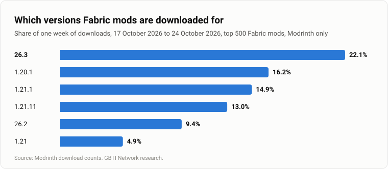
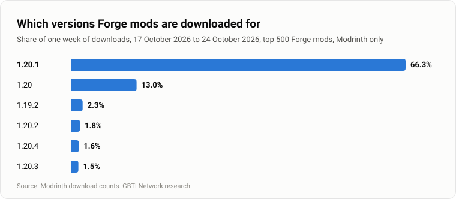
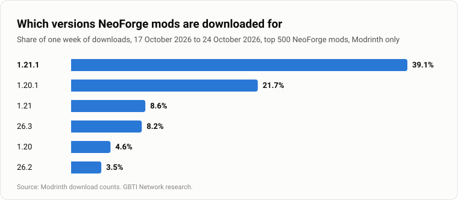
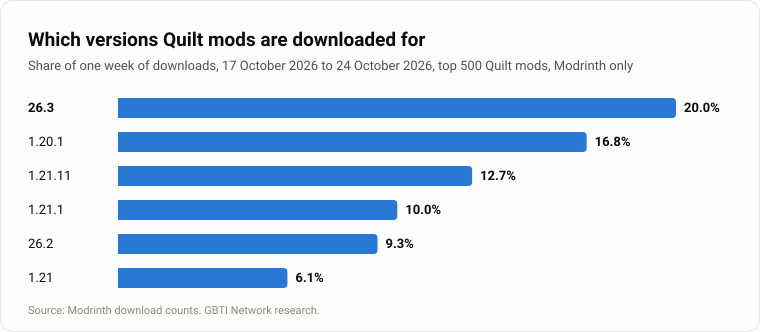

This article finds the most used version of Minecraft Java in 2026 by looking at the custom online servers people play it on. A player runs the version of the server they join, so the servers give the answer. It answers six questions:

- Which version is most used on each kind of server: plugin servers such as Paper and Purpur, and Fabric, Forge, NeoForge and Quilt?
- Which versions do Paper, Purpur and the other plugin servers run?
- How quickly did Paper, Purpur, Leaf and Folia release builds for each new Minecraft version?
- How many mod downloads do Fabric, Forge, NeoForge and Quilt each get in a week?
- How has the most used version on plugin servers changed over the years?
- Which version of Java do servers run on, and which proxy is more common, Velocity or BungeeCord?

Fabric, Forge, NeoForge and Quilt are mod loaders, the software that lets a game or a server run mods. Servers running them do not report their version to any statistics service, so the article measures them by mod downloads.

The data comes from these sources:

- [bStats global charts](https://bstats.org/global/bukkit): bStats collects usage statistics from Minecraft servers and their plugins, and its charts give the share of servers on each Minecraft version, server software and Java runtime, read several times a day from 17 October 2026 to 24 October 2026.
- [bStats per-software pages](https://bstats.org/plugin/server-implementation/paper/580): the versions on each server software (Paper's page is the one linked; the others follow the same pattern).
- [bStats proxy charts for Velocity](https://bstats.org/global/velocity) and [BungeeCord](https://bstats.org/global/bungeecord): the proxy counts.
- [Modrinth API](https://api.modrinth.com/v2): one week of downloads, 17 October 2026 to 24 October 2026, for the 500 most downloaded mods of each loader, split by Minecraft version.
- [CurseForge API](https://api.curseforge.com): each loader's total downloads for the same week.
- [Internet Archive](https://web.archive.org/): archived copies of the bStats version chart since July 2018, for the most used version over time.
- The build lists of [PaperMC](https://fill.papermc.io/v3/projects/paper), [Purpur](https://api.purpurmc.org/v2/purpur) and [Leaf](https://api.leafmc.one/v2/projects/leaf): when each one shipped a build for each new Minecraft version.
- [Mojang's version manifest](https://piston-meta.mojang.com/mc/game/version_manifest_v2.json): the release dates and the list of every Java release.

The answer for each kind of server comes first, with a note on Mojang's year-based version numbers. Then come Paper and the other plugin servers, the four mod loaders one by one, how the most used version has changed over the years, and Java and proxies. The article ends with how we measured, short answers to three common questions, and the sources.

## The most used Minecraft Java version on each kind of server

Each kind of server is measured with the best public data that exists for it. For plugin servers (Paper, Purpur, Spigot and the others that run plugins), that is the servers reporting to bStats. For Fabric, Forge, NeoForge and Quilt, it is one week of downloads, 17 October 2026 to 24 October 2026, of each loader's 500 most downloaded mods on Modrinth, a mod hosting site. A share of servers and a share of downloads measure different things, so read each row on its own.

<!-- sort: off -->
| Server | Most used | Share | Measured by |
|---|---|---|---|
| Plugin servers | 26.3 | 23.38% | servers, bStats |
| Fabric | 26.3 | 22.14% | mod downloads, Modrinth |
| Forge | 1.20.1 | 66.30% | mod downloads, Modrinth |
| NeoForge | 1.21.1 | 39.10% | mod downloads, Modrinth |
| Quilt | 26.3 | 20.00% | mod downloads, Modrinth |

On 24 October 2026, 26.3 was the most used version on plugin servers: it ran on 23.38% of the 196,558 that reported a known Minecraft release to bStats. 1.21.11 and 26.2 were close behind, at 23.12% and 23.06%. We read bStats 55 times that week, and 26.2 led in 50 of those readings; 26.3 moved ahead only on the last day.

Mod downloads come from players and servers alike, so the four loader rows describe both. Only each loader's top version is certain. Many mod files support several Minecraft versions, so we split their downloads evenly between them; counted another way, the order below first place changes. For Quilt even first place is close, as the Quilt section explains.

Servers running Mojang's own server software, with no plugins or mods, report to no statistics service either, so they have no row.

### Mojang's year-based version numbers

Mojang [announced](https://www.minecraft.net/en-us/article/minecraft-new-version-numbering-system) on 2 December 2025 that Minecraft would number its versions by year. The first number is the year, the second is the release within that year, and the third is the hotfix, so 26.1.2 is the second hotfix of the first release of 2026. The last version numbered the old way, starting with "1.", was 1.21.11, according to the [Minecraft Wiki](https://minecraft.wiki/w/Version_formats).

## Paper and the other plugin servers

26.3, 1.21.11 and 26.2 together run on 69.55% of the 196,558 plugin servers. Just over half of all servers (53.67%) run one of the new year-based versions, and 36.46% are still on a 1.21.x version. A few older versions hold on: 1.20.1 at 2.20% and 1.8.8 at 2.15%.

After the ten most used versions, 58 others share the remaining 7.99%. The number of plugin servers reporting to bStats grew from about 150,000 a month on average in October 2023 to about 188,000 in October 2026.


bStats also records which server software each server runs, in a separate chart that counts 190,740 servers. Paper runs on 74.39% of them, Purpur on 9.05%, Spigot on 6.30%, Leaf on 2.31%, UniverseSpigot on 1.10%, [Arclight](https://github.com/IzzelAliz/Arclight) on 0.80% and Folia on 0.71%. Another 2.77% report a name bStats does not recognize.


Paper servers are the most up to date: 63.58% of them run a year-based version. Purpur sits close to the overall figures, with 53.72% on a year-based version and 1.21.11 narrowly its most used version at 24.81%. The others lag further: 1.21.11 is still the most used version on Leaf (51.14%), UniverseSpigot (42.42%) and Folia (33.47%), and Folia has another 22.64% on 26.1.2. Spigot has no version chart of its own, so its servers appear only in the overall figures.

![Which Minecraft Java versions servers run, by server software, read 24 October 2026. All servers (196,558 servers): 26.3 23.4%, 26.2 23.1%, 26.1.x 7.2%, 1.21.11 23.1%, Older versions 23.2%. Paper (178,346 servers): 26.3 30.5%, 26.2 25.4%, 26.1.x 7.7%, 1.21.11 19.8%, Older versions 16.6%. Purpur (20,870 servers): 26.3 22.6%, 26.2 23.3%, 26.1.x 7.8%, 1.21.11 24.8%, Older versions 21.5%. Leaf (4,703 servers): 26.3 8.9%, 26.2 22.0%, 26.1.x 3.1%, 1.21.11 51.1%, Older versions 14.8%. UniverseSpigot (2,442 servers): 26.3 7.7%, 26.2 23.5%, 26.1.x 3.5%, 1.21.11 42.4%, Older versions 22.9%. Folia (2,160 servers): 26.3 11.8%, 26.2 25.6%, 26.1.x 22.6%, 1.21.11 33.5%, Older versions 6.5%. Mohist (1,189 servers): 26.3 0.0%, 26.2 0.0%, 26.1.x 0.0%, 1.21.11 0.0%, Older versions 100.0%.](./images/version-mix-by-software.svg)

### When each server software shipped the new versions

The table counts the days from Mojang's release of each version to the first build each server software published for it, and to its first build marked stable. Paper marked 26.3 stable 26 days after Mojang released it, and Folia's first 26.3 build, an early test build, came 29 days after. Leaf marks every build for the new year-based versions as experimental so far, and Purpur does not label its builds stable or unstable at all, so neither has a stable date.

<!-- sort: off -->
| Version | Server software | First build | First stable build |
|---|---|---|---|
| 26.1.2 | Paper | 2.1 days (alpha) | 21.9 days |
| 26.1.2 | Purpur | 3.5 days (build result only) | no release channel |
| 26.1.2 | Leaf | 67.4 days (experimental) | none yet |
| 26.1.2 | Folia | 26.9 days (stable) | 26.9 days |
| 26.2 | Paper | 0.1 days (alpha) | 40.2 days |
| 26.2 | Purpur | 1.6 days (build result only) | no release channel |
| 26.2 | Leaf | 1.3 days (experimental) | none yet |
| 26.2 | Folia | 41.8 days (beta) | none yet |
| 26.3 | Paper | 0.2 days (alpha) | 26.2 days |
| 26.3 | Purpur | 0.6 days (build result only) | no release channel |
| 26.3 | Leaf | 17 days (experimental) | none yet |
| 26.3 | Folia | 29.4 days (alpha) | none yet |

*Days from Mojang's release. Build lists read 17 October 2026.*

PaperMC, the team behind Paper, lists only 26.3 and 26.2 as supported, and it ended support for 1.21.11 on 15 June 2026, yet about one Paper server in five (19.80%) still runs it.

### Forge and NeoForge hybrids

Hybrid servers run plugins and Forge or NeoForge mods together. bStats counts six of them, and each runs mostly one version:

| Hybrid | Servers reporting a version | Main version | Share on it |
|---|---|---|---|
| Mohist | 1,189 | 1.20.1 | 69.64% |
| Youer | 664 | 1.21.1 | 90.21% |
| Magma | 26 | 1.12.2 | 80.77% |
| Magma Maintained | 47 | 1.12.2 | 85.11% |
| Ketting | 40 | 1.20.1 | 97.50% |
| LoliServer | 35 | 1.16.5 | 88.57% |

*bStats, read 24 October 2026. Mohist and Youer are read from their own version strings.*

Arclight, the largest hybrid at 0.80% of servers, has no bStats page of its own, so its versions cannot be counted.

## Fabric

Fabric's most downloaded version is 26.3 at 22.14%. The next two are 1.20.1 at 16.19% and 1.21.1 at 14.89%. These are shares of one week of downloads of the 500 most downloaded Fabric mods on Modrinth, by players and servers together.



### Fabric API by version

Fabric API is a library mod that most Fabric mods need, according to Fabric's own [documentation](https://docs.fabricmc.net/players/installing-mods), so its downloads are the clearest single sign of which versions Fabric players and servers use.

| Minecraft version | Weekly downloads | Share of the week |
|---|---|---|
| 26.3 | 2,745,580 | 37.96% |
| 1.21.11 | 1,292,528 | 17.87% |
| 26.2 | 837,048 | 11.57% |
| 1.21.1 | 802,316 | 11.09% |
| 1.20.1 | 562,513 | 7.78% |
| 1.21.4 | 145,301 | 2.01% |

*Fabric API on Modrinth, 17 October 2026 to 24 October 2026.*

### Side by side with Paper

This chart sets Paper's versions next to Fabric's. Paper's side is a share of servers, and Fabric's is a share of a week's mod downloads.


## Forge

Forge's most downloaded version is 1.20.1 at 66.30%, ahead of 1.20 at 13.02%. Forge [treats](https://forums.minecraftforge.net/topic/154387-forge-474-minecraft-1201/) 1.20.1 as its long-term version.



bStats does count a few Forge servers: hybrids that run plugins alongside Forge mods. Mohist, one of them, has 1,189 servers reporting a version, and 69.64% of them run 1.20.1, the version Forge mods are downloaded for most. Ketting, another, has 40, and 97.50% run 1.20.1.

## NeoForge

NeoForge's most downloaded version is 1.21.1 at 39.10%, followed by 1.20.1 at 21.71%. NeoForge [treats](https://neoforged.net/news/21.2release/) 1.21.1 as its long-term version. In March 2026 NeoForge [said](https://neoforged.net/news/26.1release/) 26.1 would likely replace 1.21.1 as the next stable modding version. In the week we measured, the year-based versions took 13.86% of NeoForge's Modrinth downloads, so that switch has not happened yet.



Youer, a NeoForge hybrid that bStats counts, has 664 servers reporting a version, and 90.21% of them run 1.21.1, NeoForge's most downloaded version.

## Quilt

Quilt's most downloaded version is 26.3 at 20.00%. The next two are 1.20.1 at 16.80% and 1.21.11 at 12.69%.



Quilt's lead is not firm. Part of 26.3's share comes from mod updates released during the week; counting only mod files that existed before the week, 1.20.1 comes out narrowly ahead of 26.3.

## Downloads across the four loaders

This table gives each loader's total downloads for the week on Modrinth and on CurseForge, the two mod sites we measured. A mod made for several loaders counts in each of their rows, so the rows cannot be added together. CurseForge appears only here, because its per-version download counts barely moved during the week.

| Loader | Modrinth, weekly downloads | CurseForge, weekly downloads |
|---|---|---|
| Fabric | 263,147,623 | 241,759,579 |
| Forge | 206,867,186 | 275,835,894 |
| NeoForge | 237,817,761 | 289,926,225 |
| Quilt | 168,295,563 | 124,002,301 |

*The 500 most downloaded mods per loader, 17 October 2026 to 24 October 2026.*

## Version leaders on plugin servers since 2018

The oldest copy of bStats' version chart in the Internet Archive is from July 2018, so that is where this history starts. In the archived copies, 15 different versions held the top spot, starting with 1.12.2 at 49.40% in July 2018. The highest share any version reached was 51.83%, by 1.20.1 in September 2023, and 1.21.11 reached 48.05% in March 2026.

1.21.4 held the top spot longest, in nine copies in a row from February 2025 to August 2025. Leaders have held between 19.61% and 51.83%, so 26.3's 23.38% is within the usual range. The archive has no copies from August 2018 to July 2020, which the chart marks, and other months it missed may hide versions that led briefly.

![The most used Minecraft Java version on servers reporting to bStats, at each archived reading from 2018 to 2026 and our reading of 24 October 2026, with its highest share while it led: 1.12.2 (Jul 2018) 49.4%; 1.16.1 (Aug 2020 to Sep 2020) 39.8%; 1.16.5 (Feb 2021) 38.7%; 1.17.1 (Sep 2021) 45.2%; 1.18.2 (Apr 2022 to Jun 2022) 45.9%; 1.19 (Jul 2022 to Aug 2022) 34.0%; 1.19.2 (Oct 2022 to Nov 2022) 45.9%; 1.19.3 (Feb 2023 to Mar 2023) 38.0%; 1.20.1 (Jul 2023 to Jan 2024) 51.8%; 1.20.4 (Mar 2024 to Jun 2024) 42.0%; 1.21 (Aug 2024 to Sep 2024) 34.2%; 1.21.1 (Sep 2024) 24.2%; 1.21.4 (Feb 2025 to Aug 2025) 40.2%; 1.21.8 (Oct 2025 to Nov 2025) 25.8%; 1.21.11 (Mar 2026) 48.0%; 26.3 (our reading, Oct 2026) 23.4%. The archive has no copies from August 2018 to July 2020.](./images/most-used-version-since-2018.svg)

### Servers still on 1.8

In July 2018, 31.40% of servers ran a 1.8 release. Now 2.18% do. Version 1.9 changed combat by adding an attack cooldown, according to Mojang's [release notes](https://web.archive.org/web/20161218214458/http://mojang.com/2016/02/minecraft-19-combat-update/), and Hypixel [said](https://hypixel.net/threads/hypixel-now-supports-minecraft-version-1-13.1698790/) in 2018 that it was still optimized for 1.8.9. Neither source says why other servers stayed on 1.8.


## Java runtimes and proxies

Minecraft servers run on Java, the programming language. Of the servers reporting to bStats, 66.34% run Java 25 and 23.78% run Java 21. Every year-based version needs Java 25 ([Mojang](https://www.minecraft.net/en-us/article/minecraft-java-edition-26-1)), and more servers run Java 25 than run a year-based version (53.67%), so some servers still on 1.21 already use Java 25.


A proxy joins several servers into one network that players move between. Velocity passed BungeeCord in July 2024, by monthly average, and in October 2026 Velocity averaged 13,391 proxies to BungeeCord's 2,115, counting only proxies that run at least one bStats plugin.


## How we measured

We measured plugin servers through bStats, which collects statistics from every server running a plugin that reports to it. We read its overall version, software, Java and proxy charts, plus the version chart each server software publishes there. We took full readings on the first, fourth and last day of the week from 17 October 2026 to 24 October 2026, and a shorter reading every three hours in between. For Fabric, Forge, NeoForge and Quilt we counted downloads of the 500 most downloaded mods on Modrinth during the same week. From CurseForge we used only each loader's weekly total, because its per-version counters barely moved.

```reveal Show the full method
---
bStats numbers count servers that run at least one plugin with bStats enabled. Each server submits once every 30 minutes to the global charts, and the same server appears once no matter how many bStats plugins it runs. bStats caps submissions at 16 servers per IP address each half hour on the global charts, and at 8 per IP on per-software pages. Servers behind a single address that run more than that are undercounted.

We took full readings on the first, fourth and last day of the week from 17 October 2026 to 24 October 2026: the version, software, Java runtime and proxy charts, and every per-software version page that bStats lists. Every three hours in between, a shorter reading recorded the global version and software charts and the version charts of Paper, Purpur, Leaf, UniverseSpigot and Folia. Three of those were missed on 18 October, when the machine taking them was off.

For mod loaders we tallied downloads on Modrinth for the 500 most downloaded mods of each loader from 17 October 2026 to 24 October 2026. Those 500 mods covered between 69.51% and 91.71% of each loader's Modrinth downloads that week. A mod built for multiple loaders counts toward each loader's total. Modrinth counts one download per address per project in any 15 seconds, and at most six per address per project in six hours.

Version strings were cleaned against Mojang's version manifest. Strings that matched a known Java release were grouped under that release. Anything else, such as mod version strings, git builds and typos, was counted as other and left out of the shares.

CurseForge counts downloads per mod and per file. During the week its per-file counts grew by only 1.8% as much as its per-mod counts, so its per-version figures could not be used, and the article uses CurseForge's weekly totals per loader instead.

The limits of this measurement are:
- Servers with bStats switched off are missing entirely.
- ViaVersion and ViaBackwards allow players to join on a different client version than the server runs, so the server version chart does not necessarily match the versions players use.
- Proxy counts include only those proxies that run at least one bStats plugin.
```

## Short answers about Minecraft Java versions

**What is the latest version of Minecraft Java?** The latest release is 26.3. Mojang shipped it on 15 September 2026.

**Which versions do Fabric and Forge players use most?** On Modrinth, in the week we measured, Fabric's most downloaded version was 26.3. Forge's was 1.20.1. NeoForge's was 1.21.1, and Quilt's was 26.3.

**Why do some servers still run 1.8?** The sources do not state a reason. Hypixel said in 2018 that it was still optimized for 1.8.9, but that does not explain why other servers stayed.

## Sources

- [bStats global Bukkit charts](https://bstats.org/global/bukkit): server versions, software, Java runtimes and historical counts.
- [bStats Velocity](https://bstats.org/global/velocity) and [BungeeCord](https://bstats.org/global/bungeecord) charts: proxy counts.
- [bStats per-software pages](https://bstats.org/plugin/server-implementation/paper/580): versions on each server software (Paper's page shown; the others follow the same address pattern).
- [bStats software API](https://bstats.org/api/v2/software): per-IP submission caps.
- [Internet Archive](https://web.archive.org/): archived bStats charts from 2018 to 2026.
- [Mojang version manifest](https://piston-meta.mojang.com/mc/game/version_manifest_v2.json): Java release dates and strings.
- [Mojang new-version numbering](https://www.minecraft.net/en-us/article/minecraft-new-version-numbering-system): the year-based scheme and Java's hotfix format.
- [Minecraft Wiki version formats](https://minecraft.wiki/w/Version_formats): 1.21.11 as the last "1." release.
- [PaperMC downloads service](https://fill.papermc.io/v3/projects/paper): build dates and support status for Paper and Folia.
- [Purpur downloads API](https://api.purpurmc.org/v2/purpur): Purpur build dates.
- [Leaf downloads API](https://api.leafmc.one/v2/projects/leaf): Leaf build dates and release channels.
- [Mojang 26.1 release notes](https://www.minecraft.net/en-us/article/minecraft-java-edition-26-1): Java 25 requirement.
- [Mojang 1.9 combat update](https://web.archive.org/web/20161218214458/http://mojang.com/2016/02/minecraft-19-combat-update/): attack cooldown.
- [Hypixel 1.8.9 statement](https://hypixel.net/threads/hypixel-now-supports-minecraft-version-1-13.1698790/): optimization for 1.8.9.
- [ViaVersion](https://github.com/ViaVersion/ViaVersion): version proxying between client and server.
- [Modrinth API](https://api.modrinth.com/v2): mod downloads by loader and version.
- [Modrinth Labrinth server code](https://github.com/modrinth/code): download counting rules.
- [CurseForge API](https://api.curseforge.com): weekly loader download totals.
- [Forge 1.20.1 policy](https://forums.minecraftforge.net/topic/154387-forge-474-minecraft-1201/): long-term version plan.
- [NeoForge 21.2 release](https://neoforged.net/news/21.2release/): 1.21.1 as the recommended maintenance version.
- [NeoForge 26.1 release](https://neoforged.net/news/26.1release/): 26.1 as the expected next stable version.
- [Fabric API docs](https://docs.fabricmc.net/players/installing-mods): majority of mods require Fabric API.
- [Arclight](https://github.com/IzzelAliz/Arclight): hybrid server implementation.
