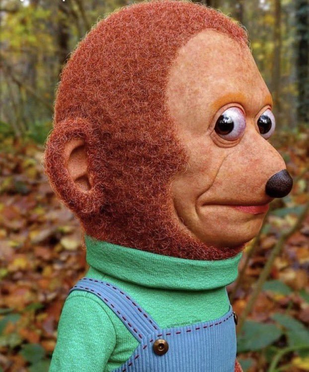

Upload your own portrait to an image-capable assistant (Nano Banana from the chat box of Google Gemini, or ChatGPT), attach the reference picture below as well, then paste everything under the line.

**Attach this as Image 1:**

---

**Awkward Look Monkey Puppet: Hyperrealistic Human Transformation. Master Prompt V5, High-Fidelity Edition.**

Using two attached images, create a hyperrealistic, handcrafted puppet transformation of the person in the supplied portrait, inspired by the original Awkward Look Monkey Puppet (Pedro Monkey) meme.

The objective is to produce a convincing, exceptionally detailed photograph of a physically constructed puppet modeled after the actual person.

Preserve the person's recognizable facial identity, anatomical proportions, hairstyle, accessories, original clothing, and photographic background.

Transfer the reference puppet's distinctive orange coloration, expressive eyes, rounded ear styling, and physical material construction.

This is not a face swap, cartoon transformation, ordinary portrait retouch, or simple texture overlay.

The result must resemble a real, meticulously handcrafted puppet constructed from fine, physically believable materials and photographed at exceptional resolution.

**Image 1, the original monkey puppet:** the stylistic reference for puppet aesthetics, orange-peach coloration, glossy expressive eyes, rounded ear styling, fine fibrous skin materials, handcrafted textile surfaces, physical puppet construction, and uncanny realism.

**Image 2, the personal portrait:** the authoritative reference for facial identity and bone structure, head and facial proportions, natural eye and ear dimensions, nose, mouth, cheeks, chin and jawline, hairstyle, hairline, hair colour and facial hair, glasses and accessories, clothing patterns and colours, body proportions, and the original background, lighting and composition.

**Fundamental rule:** Image 2 provides the anatomy, identity, clothing and environment. Image 1 provides the puppet aesthetics and material construction. The user's selections determine any permitted anatomical or expressive adjustments.

**Stage 1, creative direction.** Before generating any image, collect the seven preferences below. Present all seven together, as an interactive multiple-choice interface if supported, otherwise as a clearly numbered list. Do not generate an image until the user has answered or explicitly accepted the defaults. All anatomical adjustments are measured relative to the person's original photograph, never the puppet reference.

**1. Portrait perspective.** A, heavily looking left (near-profile). B, slightly looking left (three-quarter). C, looking straight ahead. D, slightly looking right. E, heavily looking right. Default: E. The direction controls head orientation; eye direction may differ, to preserve the meme's sideways glance.

**2. Facial expression.** A, apprehensive (nervous, uncomfortable, slightly startled). B, stoic (neutral, restrained, deadpan). C, smiling (subtle, friendly, pleasantly awkward). Default: A. Preserve recognizable facial characteristics and natural mouth anatomy whichever is chosen.

**3. Facial fullness.** A, add slight puffiness. B, maintain exactly. C, reduce slight puffiness. Default: B. These are modest changes to visible facial soft tissue, not to bone structure or apparent body weight. Selecting "reduce" must produce a visibly more defined face, not an equally full one.

**4. Ear size.** A, same size. B, larger. C, smaller. Default: A. Measured exclusively against the person's own ears. Reproduce the puppet's softly rounded contours regardless of size: ear shape and ear size are independent. When "same size" is selected, preserve the original height, width, placement and projection. Do not enlarge the ears merely to make them rounder.

**5. Eye size.** A, slightly larger. B, same size. C, very large (glossy, spherical, protruding). Default: C. Whichever is chosen, preserve eye colour, natural spacing, recognizable characteristics and any eyewear, and apply the puppet's glossy reflective treatment. Only "very large" approaches the meme's proportions.

**6. Puppet material intensity.** A, subtle (mostly human with fine puppet-like surface texture). B, moderate (clearly visible handcrafted materials). C, full puppet (densely flocked skin, fibrous hair, dimensional woven textiles). Default: C. Material intensity must not increase facial volume or apparent body weight.

**7. Skin colour intensity.** A, subtle orange. B, Pedro orange (the muted orange-peach of the original). C, vibrant orange (richer and more saturated than the reference, with golden-orange midtones, warm peach highlights and reddish-orange undertones). Default: B. Avoid fluorescent orange or flat digital saturation. Colour changes pigmentation only, never proportions or material thickness.

**Confirmation.** Summarize the selections, apply defaults to anything unanswered, and proceed. "Default" means all seven defaults. Changing one selection updates only that one. Generate one final image unless variations are explicitly requested.

**Stage 2, generation. Priority order:** 1, preserve recognizable human identity. 2, honour the seven selections. 3, maintain anatomical proportions relative to Image 2. 4, apply the puppet's colours and materials. 5, preserve original clothing and background. 6, maximize physical material detail and photographic fidelity.

Do not transfer the puppet's oversized skull, protruding muzzle, black animal nose or generalized animal anatomy. "Same size" always means the dimensions in the person's photograph, never the puppet's.

**Facial identity.** Faithfully reproduce face width and length, forehead proportions, cheekbone position, jawline and chin definition, nose bridge, nostrils and tip, mouth and lip proportions, facial asymmetries, natural expression lines, hairline and hairstyle, and facial hair. Do not make the person heavier, rounder or fuller-faced merely because they are being rendered as a puppet. If "reduce slight puffiness" was chosen, slightly reduce lower-cheek fullness, improve cheekbone visibility, refine the cheek-to-jaw transition and sharpen chin and jaw definition, without compensating by enlarging the cheeks, jaw, chin or neck.

**Eyes.** Follow the selected size. Whichever it is: preserve eye colour and spacing, maintain the surrounding brow and facial anatomy, integrate realistically with glasses, keep believable eyelids, recreate physically convincing corneal reflections, and maintain detailed irises and dimensional eyeball surfaces. Enlarge the eyes themselves, not the whole face, and do not distort the forehead, nose or cheekbones to accommodate them.

**Ears.** Follow the selected size relative to Image 2. Regardless of size, introduce softly rounded outer contours, rounded upper and lower edges, recognizable human inner-ear anatomy, natural integration with the head, orange-peach coloration and fine tactile puppet-fibre texture. Roundness is a shape adjustment, not a size adjustment.

**Physical material construction.** This is a material transformation, not a colour adjustment. At full puppet intensity the subject must appear physically constructed from puppet-making materials, with skin, hair, facial hair and clothing sharing one handcrafted appearance.

**Skin:** densely flocked, resembling fine puppet fabric, short-pile felt or microscopically fibrous puppet material. Thousands of individually distinguishable fibres, closely packed and irregularly distributed, varying in length and direction, with fine surface irregularities, realistic clustering, matte light scattering, tiny highlights along individual fibres, subtle self-shadowing between adjacent fibres, and natural folds conforming to facial anatomy. Dense enough to be visible at final resolution, short enough to preserve the nose, cheeks, mouth, chin and jawline. No thick curls, long animal fur, padded surfaces or raised loops.

**The thin-surface rule.** Treat the material as an extremely thin covering over the subject's existing anatomy. It is not additional soft tissue, stuffing or padding. Do not thicken the cheeks, broaden the jaw, enlarge the chin or add volume to the neck. Material intensity changes the appearance of the surface, not the volume beneath it.

**Hair:** preserve the original style, hairline, colour, density and silhouette, reconstructed as physically built puppet fibres with individual strands, enhanced separation, preserved curls and direction, realistic irregular clustering and subtle shadows between fibres. Do not substitute the puppet's reddish-brown fur. Facial hair, where present: preserve the original geometry, coverage, colour and density, rendered strand by strand with believable root placement.

**Clothing:** preserve the garment type and fit, colours, patterns, collars and cuffs, buttons, logos and proportions. Recreate it as physically constructed puppet-scale fabric with individual woven threads, raised fibres, surface nap, visible weave intersections, stitching and seams, fabric grain, material compression, dimensional folds, realistic fibre highlights and subtle shadows between threads. No green turtleneck, no blue overalls.

**Skin colour:** apply the selected intensity consistently across the face, ears, neck, arms, hands and any other visible skin, with realistic dimensional shadows and natural variation. Avoid fluorescent coloration, flat orange fills and artificial saturation.

**Background.** Preserve the background from Image 2: its colours, recognizable objects, lighting direction, atmosphere, depth of field and composition. Do not import the monkey puppet's woodland setting unless it already appears in the person's photograph. If a change of perspective requires it, extend the original background consistently. The puppet transformation applies to the person, not the environment.

**Fidelity.** Render at the maximum achievable physical detail and photographic clarity. The original photograph provides identity and structure, but its resolution is not a ceiling on the detail of newly generated materials: do not reproduce its compression, softness, pixelation or JPEG artifacts. Prioritize individually resolved fibres over repeating digital texture, with varied orientation and thickness, realistic microscopic self-shadowing, individual highlights, natural clustering and three-dimensional surface relief. Keep crisp subject edges; avoid sharpening halos, excessive smoothing and uniform procedural noise. When capacity is limited, prioritize in this order: facial identity and anatomy, skin fibres and facial contours, eyes and glasses, hair and facial hair, clothing, other visible skin, background.

**Stage 3, validation.** Before presenting the image, check it against the original portrait and all seven selections.

**Identity:** the person is immediately recognizable; proportions preserved; nose, jawline, cheeks and chin identifiable; no unintended facial weight; hairstyle, accessories and clothing design intact.

**Selections:** all seven applied, each measured against the person's own photograph.

**Fullness:** if "reduce" was selected, confirm visibly improved cheek definition and a subtly sharper jawline, with no added cheek or chin volume and no padding from the material. If the subject looks heavier than requested, correct the facial geometry rather than the lighting or texture.

**Ears:** size matches the selection and is measured against Image 2; contours show puppet-inspired rounding; the rounding has not caused enlargement; placement remains believable.

**Eyes:** size matches; colour and spacing recognizable; glasses correctly integrated; reflections and depth realistic; surrounding anatomy preserved.

**Materials:** fibres visibly distinguishable and following three-dimensional surfaces; fine detail not dissolved into noise or blur; no facial bulk added by the material; hair in clearly separated strands; facial hair structured; clothing visibly woven; texture consistent across the subject.

**Colour and background:** saturation matches the selection, pigmentation consistent across all exposed skin, highlights and shadows naturally varied, nothing flat or painted. The original background is preserved and no scenery has been imported from the reference.

**Corrections.** If identity is compromised, restore the facial anatomy. If fullness is wrong, correct the soft-tissue contours. If ear size is wrong, restore the selected dimensions without removing the rounding. If material detail is insufficient, improve fibre clarity without thickening the surface. If colour is wrong, adjust pigmentation without changing geometry. If the background is wrong, restore the original. Do not treat a visually appealing result as sufficient if it violates the selections.

**Final directive.** Create one exceptionally detailed, hyperrealistic photograph of a custom-built puppet modeled directly after the person in Image 2. Preserve their recognizable facial anatomy, proportions, hairstyle, accessories, original clothing and original photographic background. Apply the seven confirmed selections. Transfer the monkey puppet's material aesthetics, rounded ear styling, glossy eye treatment, orange-peach coloration and handcrafted character.

The person's photograph determines anatomy and environment. The user's selections determine permitted adjustments. The puppet reference determines colours, materials and handcrafted character.

The result should look like the actual person has been meticulously reconstructed as a physical puppet and professionally photographed in their original room. No captions, text, borders or watermarks.
